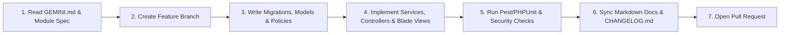

# Contributing Guide & Antigravity Engineering Workflow

**Last Updated:** 2026-11-17  
**Status:** `Active Governance Standard`

## 1. Development Workflow Overview

Development on **Sales CRM** is performed using **Google Gemini Antigravity IDE** guided by this Markdown documentation suite. Every contributor and AI agent session must follow a documentation-first, test-verified workflow.

## 2. Branching Strategy

- `main` — Production-ready, tagged releases only. Protected branch.
- `develop` — Integration branch for verified phase deliverables.
- `feature/<module>-<short-description>` — New CRM features (e.g., `feature/leads-atomic-conversion`).
- `fix/<module>-<bug-description>` — Bug fixes with accompanying regression tests.
- `docs/<topic>` — Documentation-only updates.

## 3. Commit Message Convention (Conventional Commits)

Format: `<type>(<scope>): <imperative summary>`

- `feat(leads): implement atomic lead conversion service and policy`
- `fix(quotations): prevent rounding drift on line item tax calculation`
- `test(deals): add cross-team IDOR authorization tests for stage movement`
- `docs(database): add composite index specification for follow_ups table`
- `refactor(pipeline): extract stage reordering logic into ReorderStagesAction`

## 4. Definition of Done (Pull Request Checklist)

Every feature or bugfix PR must satisfy all of the following before merge:

1. **Architecture Alignment:** Controllers are thin; validation lives in `FormRequest` classes; domain logic resides in `app/Services/` or `app/Actions/`.
2. **Frontend Compliance:** Uses Blade components, [Tailwind CSS v4](https://tailwindcss.com/docs/upgrade-guide) utility classes, and Vanilla JS (or justified Alpine.js). No unapproved JS frameworks.
3. **Database Safety:** Migrations include `down()` methods, appropriate foreign key constraints, and composite indexes matching query filters. No N+1 queries.
4. **Security Verification:** Every route enforces authentication, Policy authorization (`$this->authorize()`), team visibility scopes (`visibleTo($user)`), and CSRF protection.
5. **Automated Tests:** Includes passing Feature, Unit, and Authorization tests (`php artisan test`).
6. **Documentation Synchronization:** Updates implementation status in `PROJECT_STATUS.md`, the relevant `docs/modules/<module>.md` file, and `CHANGELOG.md`.
