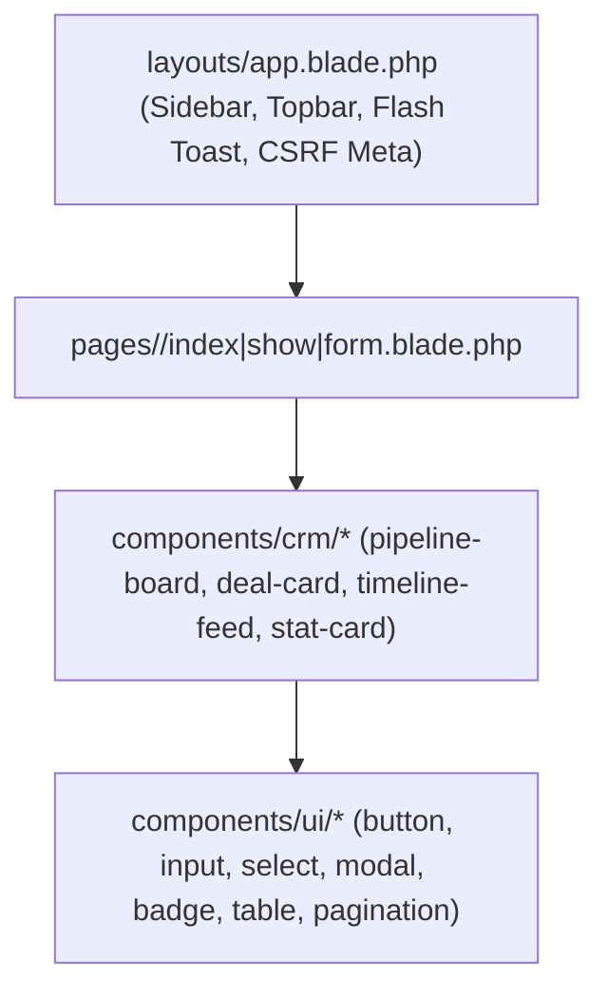

# Frontend Architecture — Sale Fusion CRM

**Last Updated:** 2026-11-19  
**Implementation Status:** `Implemented (Active Engineering Specification)`  
**Related Docs:** `docs/adr/ADR-004-frontend-architecture.md`, `docs/architecture/coding-standards.md`

## 1. Frontend Stack & Philosophy

The frontend uses **Server-Side Rendered (SSR) Laravel Blade** styled with **[Tailwind CSS v4](https://tailwindcss.com/docs/upgrade-guide)** and enhanced with **Vanilla ES2022 JavaScript** bundled via **Vite**.

### Why Blade + Tailwind CSS v4 + Vanilla JS?
- **Zero Hydration Overhead:** Instant server rendering without duplicating routing, validation, or RBAC state in a heavy SPA client.
- **CSS-First Design System:** [Tailwind CSS v4](https://tailwindcss.com/docs/upgrade-guide) replaces `tailwind.config.js` with native CSS `@import "tailwindcss";` and `@theme` variables compiled at high speed via `@tailwindcss/vite`.
- **Strict Dependency Discipline:** Alpine.js (`~15KB`) is permitted **only** on high-interactivity views (Pipeline Kanban board, Quotation dynamic line-item calculator, accessible modal/drawer state) where Vanilla JS DOM boilerplate would reduce maintainability. React, Vue, Livewire, and Inertia are strictly prohibited.

## 2. Tailwind CSS v4 Configuration (`resources/css/app.css`)

In Tailwind CSS v4, no `tailwind.config.js` file is used. All design tokens are declared directly in `resources/css/app.css`:

```css
@import "tailwindcss";

@theme {
    --font-sans: "Inter", ui-sans-serif, system-ui, sans-serif;
    --font-mono: "JetBrains Mono", ui-monospace, SFMono-Regular, monospace;

    /* Semantic CRM Brand & Surface Palette */
    --color-brand-50: oklch(0.97 0.014 254.6);
    --color-brand-100: oklch(0.93 0.032 255.5);
    --color-brand-600: oklch(0.55 0.215 262.8);
    --color-brand-700: oklch(0.48 0.205 263.3);
    --color-brand-900: oklch(0.32 0.125 265.5);

    /* Deal & Lead Stage Semantic Colors */
    --color-stage-new: oklch(0.62 0.18 250);
    --color-stage-qualified: oklch(0.65 0.17 195);
    --color-stage-proposal: oklch(0.72 0.16 75);
    --color-stage-won: oklch(0.64 0.19 148);
    --color-stage-lost: oklch(0.60 0.21 25);
}
```

## 3. Blade Component Hierarchy



### Example Reusable Blade Component (`resources/views/components/crm/status-badge.blade.php`)
```html
@props(['status', 'type' => 'lead'])

@php
    $colorClasses = match ($status) {
        'new', 'open' => 'bg-blue-50 text-blue-700 ring-blue-600/20',
        'contacted', 'in_progress' => 'bg-amber-50 text-amber-700 ring-amber-600/20',
        'qualified', 'sent' => 'bg-cyan-50 text-cyan-700 ring-cyan-600/20',
        'converted', 'won', 'accepted' => 'bg-emerald-50 text-emerald-700 ring-emerald-600/20',
        'disqualified', 'lost', 'rejected', 'expired' => 'bg-rose-50 text-rose-700 ring-rose-600/20',
        default => 'bg-slate-50 text-slate-700 ring-slate-600/20',
    };
@endphp

<span {{ $attributes->merge(['class' => "inline-flex items-center rounded-md px-2 py-1 text-xs font-medium ring-1 ring-inset {$colorClasses}"]) }}>
    {{ str($status)->replace('_', ' ')->title() }}
</span>
```

## 4. Vanilla JavaScript Architecture (`resources/js/`)

JavaScript is organized into small ES modules loaded via `resources/js/app.js` and scoped via `data-module` attributes on DOM containers:

- `resources/js/modules/http.js` — Wrapper around native `fetch()` that automatically injects `X-CSRF-TOKEN` from `<meta name="csrf-token">` and `Accept: application/json`.
- `resources/js/modules/kanban.js` — Native HTML5 Drag-and-Drop API handler for moving deal cards across pipeline stages with optimistic UI rollback on `403`/`422` errors.
- `resources/js/modules/quotation-calculator.js` — Real-time client-side preview calculation of line-item subtotals, discounts, and taxes (always re-validated and recalculated authoritatively on the server).
- `resources/js/modules/confirm-dialog.js` — Accessible `<dialog>` confirmation modal for destructive actions (delete, mark deal lost, convert lead).

## 5. Accessibility & Responsive Standards

- Every interactive control must be keyboard-accessible (`Tab`, `Enter`, `Escape`) and carry appropriate `aria-*` attributes.
- Data tables must support horizontal scroll containers on viewports `< 768px` while keeping primary action columns sticky.
- Color contrast must meet WCAG 2.1 AA (`>= 4.5:1` for normal text).
