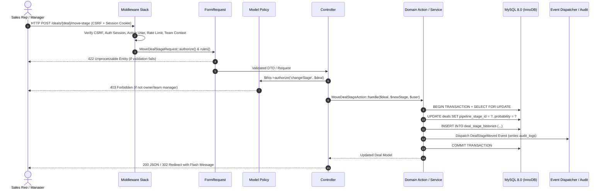

# Request & Job Lifecycle — Sales CRM

**Last Updated:** 2026-11-19  
**Implementation Status:** `Implemented (Active Engineering Specification)`  
**Related Docs:** `docs/architecture/system-architecture.md`, `docs/security/authentication.md`, `docs/security/authorization.md`

## 1. Synchronous Web / AJAX Request Lifecycle

Every incoming HTTP request passes through a deterministic security, validation, authorization, and domain execution pipeline on [Laravel 12](https://laravel.com/framework/docs/12.x/configuration).

## 2. Middleware Execution Order (`bootstrap/app.php`)

1. `TrustProxies` & `SecurityHeadersMiddleware` (`X-Frame-Options: DENY`, `X-Content-Type-Options: nosniff`, `Referrer-Policy`, `Content-Security-Policy`).
2. `EncryptCookies` & `StartSession`.
3. `ValidateCsrfToken`.
4. `Authenticate` (`auth` guard) & `EnsureUserIsActive` (immediately logs out deactivated users).
5. `ResolveTeamContext` (binds authenticated user's active `team_id` and role permissions for request duration).
6. `ThrottleRequests` (rate-limits login, exports, and API-like AJAX endpoints).
7. `SubstituteBindings` (resolves route-model bindings).

## 3. Asynchronous Queue & Scheduler Lifecycle

Heavy or time-delayed operations never block the HTTP response thread:
- **Queued Jobs (`database` or `redis` driver):**
  - `ProcessCsvImportJob` — Parses uploaded CSV/XLSX chunks (500 rows/chunk), validates rows, inserts records, and generates an error summary file.
  - `GenerateExportFileJob` — Streams filtered CRM records to a private CSV/XLSX file and notifies the requester when ready.
  - `SendNotificationMailJob` — Delivers transactional emails (quote sent, task assigned, deal won).
- **Scheduled Commands (`routes/console.php`):**
  - `crm:dispatch-due-reminders` (runs every minute) — Scans `reminders` and `follow_ups` due within the current window and dispatches notifications.
  - `crm:flag-rotting-deals` (runs hourly) — Identifies open deals exceeding their stage's `rotting_days` threshold without activity and notifies owners.
