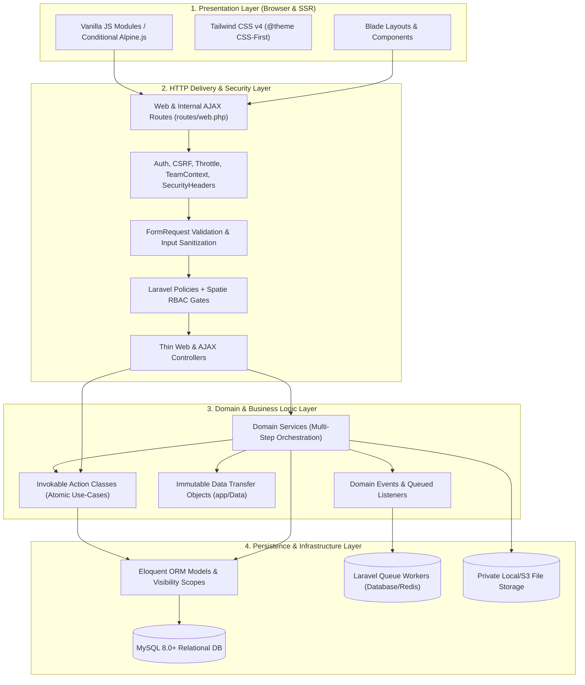

# System Architecture — Sales CRM

**Last Updated:** 2026-11-19  
**Implementation Status:** `Implemented (Production Architecture)`  
**Related Docs:** `readme.md`, `PROJECT_STATUS.md`, `docs/architecture/backend-architecture.md`, `docs/architecture/frontend-architecture.md`

## 1. Architectural Vision

**Sales CRM** is architected as a **Modular Monolith** built on [Laravel 12](https://laravel.com/framework/docs/12.x/configuration), MySQL 8.0+, Server-Side Rendered (SSR) Laravel Blade templates, [Tailwind CSS v4](https://tailwindcss.com/docs/upgrade-guide), and progressive Vanilla JavaScript enhancement.

This architecture deliberately avoids the operational complexity of distributed microservices or dual-repository SPA setups while maintaining strict domain boundaries between CRM modules (`Leads`, `Contacts`, `Companies`, `Deals`, `Quotations`, `Activities`, `Tasks`, `Reports`).

## 2. Layered System Topology

## 3. Core Architectural Principles

| Principle | Enforcement Rule | Reference |
| :--- | :--- | :--- |
| **Strict Layer Separation** | Controllers never query Eloquent directly for complex mutations; Blade views never execute database queries. | `docs/architecture/backend-architecture.md` |
| **Team & Ownership Isolation** | Every CRM entity belongs to an `owner_id` (`users.id`) and `team_id` (`teams.id`), filtered via Eloquent global/local scopes. | `docs/security/authorization.md` |
| **Atomic Financial & State Transitions** | Lead conversion, deal stage transitions, and quotation total recalculations run inside `DB::transaction()` with row locking. | `docs/database/data-integrity.md` |
| **Zero-JS-Framework Bloat** | Server-rendered HTML is the primary transport; Vanilla JS handles modals, fetch requests, and Kanban interactions. | `docs/architecture/frontend-architecture.md` |
| **Immutable Auditability** | Critical mutations emit domain events recorded synchronously or asynchronously into `audit_logs`. | `docs/modules/audit-logs.md` |

## 4. Implementation Status

- **Implemented (`100%` Core Modules):** Complete 4-tier modular monolith architecture implemented across all `14` CRM modules (`app/`, `resources/views/`, `routes/`, and `tests/Feature/`).
