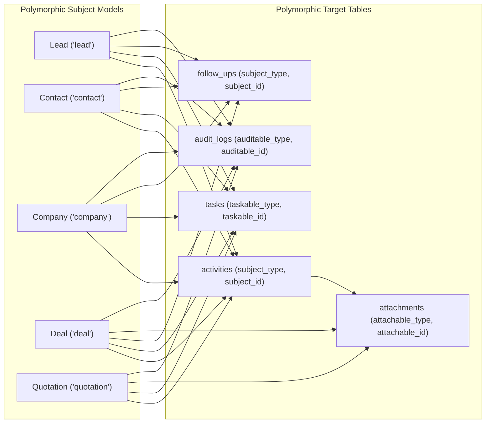

# Database Relationships & Eloquent Mapping — Sales CRM

**Last Updated:** 2026-11-17  
**Implementation Status:** `Proposed (Greenfield Blueprint)`  
**Related Docs:** `docs/database/database-design.md`, `docs/database/erd.md`, `docs/database/data-integrity.md`

## 1. Relationship Matrix Across CRM Entities (`Proposed`)

| Source Model | Relationship Method | Relation Type | Target Model | Foreign Key / Morph Key |
| :--- | :--- | :--- | :--- | :--- |
| `Team` | `users()` | `HasMany` | `User` | `users.team_id` |
| `Team` | `leader()` | `BelongsTo` | `User` | `teams.leader_id` |
| `User` | `team()` | `BelongsTo` | `Team` | `users.team_id` |
| `User` | `ownedLeads()` | `HasMany` | `Lead` | `leads.owner_id` |
| `User` | `ownedDeals()` | `HasMany` | `Deal` | `deals.owner_id` |
| `Company` | `parentCompany()` | `BelongsTo` | `Company` | `companies.parent_company_id` |
| `Company` | `subsidiaries()` | `HasMany` | `Company` | `companies.parent_company_id` |
| `Company` | `contacts()` | `HasMany` | `Contact` | `contacts.company_id` |
| `Company` | `deals()` | `HasMany` | `Deal` | `deals.company_id` |
| `Company` | `quotations()` | `HasMany` | `Quotation` | `quotations.company_id` |
| `Contact` | `company()` | `BelongsTo` | `Company` | `contacts.company_id` |
| `Contact` | `deals()` | `BelongsToMany` | `Deal` | `deal_contact` (`contact_id`, `deal_id`) |
| `Lead` | `convertedCompany()` | `BelongsTo` | `Company` | `leads.converted_company_id` |
| `Lead` | `convertedContact()` | `BelongsTo` | `Contact` | `leads.converted_contact_id` |
| `Lead` | `convertedDeal()` | `BelongsTo` | `Deal` | `leads.converted_deal_id` |
| `Pipeline` | `stages()` | `HasMany` | `PipelineStage` | `pipeline_stages.pipeline_id` (ordered by `position`) |
| `Deal` | `pipeline()` | `BelongsTo` | `Pipeline` | `deals.pipeline_id` |
| `Deal` | `stage()` | `BelongsTo` | `PipelineStage` | `deals.pipeline_stage_id` |
| `Deal` | `company()` | `BelongsTo` | `Company` | `deals.company_id` |
| `Deal` | `primaryContact()` | `BelongsTo` | `Contact` | `deals.primary_contact_id` |
| `Deal` | `contacts()` | `BelongsToMany` | `Contact` | `deal_contact` (with pivot `role`, `is_primary`) |
| `Deal` | `stageHistories()` | `HasMany` | `DealStageHistory` | `deal_stage_histories.deal_id` |
| `Deal` | `quotations()` | `HasMany` | `Quotation` | `quotations.deal_id` |
| `Quotation` | `deal()` | `BelongsTo` | `Deal` | `quotations.deal_id` |
| `Quotation` | `items()` | `HasMany` | `QuotationItem` | `quotation_items.quotation_id` (ordered by `position`) |

## 2. Polymorphic Relationships (`MorphTo` / `MorphMany`) (`Proposed`)

To avoid duplicating timeline, task, attachment, and audit tables across every CRM entity, five polymorphic hubs are used.



### Mandatory `Relation::enforceMorphMap()` Registration (`Proposed`)
Never store fully qualified PHP class names (`App\Models\Deal`) in polymorphic `*_type` columns. Register a strict morph map in `AppServiceProvider::boot()` per [Laravel 12 API Docs](https://api.laravel.com/docs/12.x/index.html):

```php
use Illuminate\Database\Eloquent\Relations\Relation;

Relation::enforceMorphMap([
    'user' => \App\Models\User::class,
    'team' => \App\Models\Team::class,
    'lead' => \App\Models\Lead::class,
    'contact' => \App\Models\Contact::class,
    'company' => \App\Models\Company::class,
    'deal' => \App\Models\Deal::class,
    'quotation' => \App\Models\Quotation::class,
    'activity' => \App\Models\Activity::class,
    'task' => \App\Models\Task::class,
    'follow_up' => \App\Models\FollowUp::class,
]);
```
