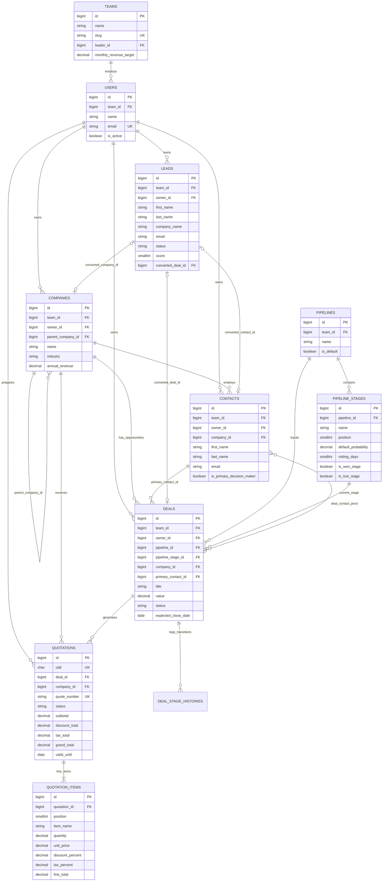
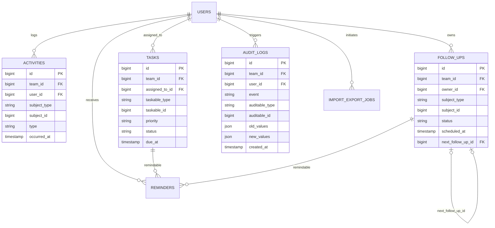

# Entity-Relationship Diagram (ERD) — Sale Fusion CRM

**Last Updated:** 2026-11-19  
**Implementation Status:** `Implemented (Active Engineering Specification)`  
**Related Docs:** `docs/database/database-design.md`, `docs/database/database-relationships.md`, `docs/database/migrations-and-indexes.md`

## 1. Core Commercial & Pipeline ERD

## 2. Polymorphic Execution & Governance ERD

