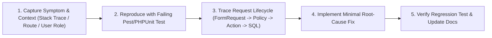

# Debugging Guide & Root-Cause Workflow — Sale Fusion CRM

**Last Updated:** 2026-11-19  
**Implementation Status:** `Implemented (Active Operational Guide)`  
**Related Docs:** `docs/debugging/troubleshooting.md`, `docs/debugging/error-handling.md`

## 1. Systematic Debugging Workflow in Gemini Antigravity IDE

## 2. Local Diagnostic Commands

| Diagnostic Goal | Command |
| :--- | :--- |
| Inspect registered routes, middleware, and policies | `php artisan route:list --path=deals` |
| Verify environment & config state | `php artisan about` |
| Tail structured application logs in real time | `php artisan pail` or `tail -f storage/logs/laravel.log` |
| Inspect pending/failed queue jobs | `php artisan queue:failed` |
| Clear stale cached config/routes/views/permissions | `php artisan optimize:clear && php artisan permission:cache-reset` |

## 3. Safe Debugging Rules

- Never leave `dd()`, `dump()`, `var_dump()`, or `console.log()` statements in committed PHP, Blade, or JavaScript files.
- Never enable `APP_DEBUG=true` in staging/production environments exposed to untrusted networks.
