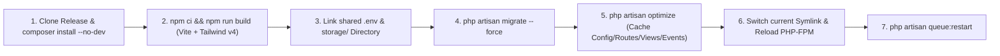

# Deployment Guide — Sale Fusion CRM

**Last Updated:** 2026-11-19  
**Implementation Status:** `Implemented (Active Operational Runbook)`  
**Related Docs:** `docs/deployment/environment-variables.md`, `docs/deployment/production-checklist.md`, `docs/deployment/queue-and-scheduler.md`

## 1. Target Production Infrastructure

- **OS:** Ubuntu 24.04 LTS
- **Web Server:** Nginx 1.24+ with TLS 1.3 and HTTP/2
- **PHP Runtime:** PHP 8.3+ FPM (`opcache.enable=1`, `opcache.validate_timestamps=0` in production, `bcmath`, `intl`, `mbstring`, `pdo_mysql`, `gd`, `zip`)
- **Database:** MySQL 8.0+ (`InnoDB`, dedicated non-root database user)
- **Process Manager:** Supervisor (managing Laravel Queue Workers)
- **Asset Bundler:** Node.js 20 LTS + Vite (for build-time compilation of [Tailwind CSS v4](https://tailwindcss.com/docs/upgrade-guide) and Vanilla JS bundles)

## 2. Zero-Downtime Atomic Deployment Sequence



## 3. Standard Release Script (`deploy.sh`)

```bash
#!/usr/bin/env bash
set -euo pipefail

composer install --no-interaction --prefer-dist --optimize-autoloader --no-dev
npm ci
npm run build

php artisan migrate --force
php artisan config:cache
php artisan route:cache
php artisan view:cache
php artisan event:cache
php artisan permission:cache-reset
php artisan queue:restart
```
