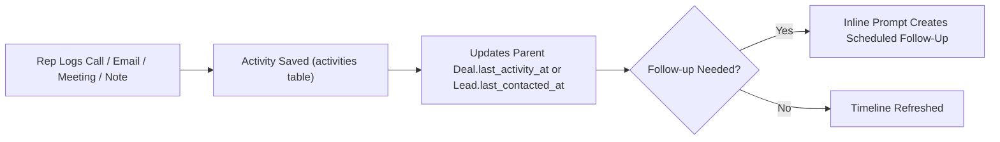

# Activities & Communications Module (MOD-08)

**Last Updated:** 2026-11-19  
**Implementation Status:** `Implemented (Production Ready — Verified by PHPUnit & Pint)`  
**Related Docs:** `PROJECT_STATUS.md`, `docs/database/database-design.md`, `docs/security/role-permission-matrix.md`

## 1. Business Objectives

Record a chronological, polymorphic timeline of all customer touchpoints (calls, emails, meetings, notes, and system events) across Leads, Contacts, Companies, and Deals.

## 2. Implementation Summary

### 2.1 Implemented Functionality
- Polymorphic activity logging (`call`, `email`, `meeting`, `note`, `system`) with direction (`inbound`, `outbound`), duration, and outcome.
- Automatic touchpoint timestamp propagation: logging an activity on a Deal or Contact updates `last_activity_at` on the Deal (resetting its rotting timer) and `last_contacted_at` on a Lead.
- Chronological activity feed with type filtering (`All`, `Calls`, `Emails`, `Meetings`, `Notes`).

## 3. Functional Requirements & User Workflows



## 4. Permissions & Access Control

| Permission Slug | Authorized Roles |
| :--- | :--- |
| `activities.view.own` | All Authenticated Roles |
| `activities.view.team` | Sales Manager, Org Admin, Super Admin, Read-Only Analyst |
| `activities.create` | Sales Rep, Sales Manager, Org Admin, Super Admin |
| `activities.update.own` | Sales Rep (own within 24h), Sales Manager, Org Admin, Super Admin |
| `activities.delete` | Sales Manager, Org Admin, Super Admin |

## 5. Business Rules

- System-generated activities (`type = 'system'`) are immutable and cannot be edited or deleted by users.
- Logging any non-note communication (`call`, `email`, `meeting`) on a Lead with `status = 'new'` automatically transitions the Lead to `status = 'contacted'` and updates `last_contacted_at`.
- Logging an activity on a Deal updates `deals.last_activity_at = occurred_at`.

## 6. Database Entities

- **Primary Schema:** `activities` (`id`, `team_id`, `user_id`, `subject_type`, `subject_id`, `type`, `direction`, `outcome`, `summary`, `body`, `duration_minutes`, `occurred_at`, `timestamps`, `softDeletes`).
- See `docs/database/migrations-and-indexes.md` for composite indexes and foreign key constraints.

## 7. Eloquent Relationships

- `Activity::subject()` -> `MorphTo()` (`lead`, `contact`, `company`, `deal`)
- `Activity::user()` -> `BelongsTo(User::class)`
- `Activity::attachments()` -> `MorphMany(Attachment::class, 'attachable')`

## 8. Input Validation Rules (`FormRequest`)

```php
// app/Http/Requests/Activities/StoreActivityRequest.php
public function rules(): array
{
    return [
        'subject_type' => ['required', 'string', Rule::in(['lead', 'contact', 'company', 'deal'])],
        'subject_id' => ['required', 'integer'],
        'type' => ['required', Rule::in(['call', 'email', 'meeting', 'note'])],
        'direction' => ['nullable', Rule::in(['inbound', 'outbound'])],
        'outcome' => ['nullable', 'string', 'max:60'],
        'summary' => ['required', 'string', 'max:255'],
        'body' => ['nullable', 'string', 'max:10000'],
        'duration_minutes' => ['nullable', 'integer', 'min:0', 'max:1440'],
        'occurred_at' => ['required', 'date'],
    ];
}
```

## 9. Edge Cases & Concurrency Handling

- Backdating an activity (`occurred_at` older than current `last_activity_at`): `deals.last_activity_at` is updated using `GREATEST(COALESCE(last_activity_at, occurred_at), occurred_at)` so backdated logs never move `last_activity_at` backward.
- Lead conversion: existing activities on the `Lead` remain visible on the converted `Deal` timeline via unified query or polymorphic re-linking.

## 10. Error Scenarios & HTTP Responses

- `422 Unprocessable Entity`: Missing `summary` or invalid `subject_type`.
- `403 Forbidden`: Attempting to edit a `system` activity or log an activity on another team's record.

## 11. UI & Frontend Requirements (Blade + Tailwind CSS v4)

Reusable `<x-crm.timeline-feed :subject="$deal" />` Blade component with quick-entry tabs (`Log Call`, `Log Email`, `Log Meeting`, `Add Note`) and chronological vertical timeline cards.

## 12. Automated Test Scenarios (Pest / PHPUnit)

- `test('logging a call on a new lead transitions status to contacted')`
- `test('logging an activity on a deal updates last_activity_at')`
- `test('system activities cannot be edited or deleted by users')`
