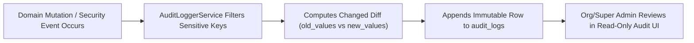

# Immutable Security & Compliance Audit Logs Module (MOD-14)

**Last Updated:** 2026-11-17  
**Implementation Status:** `Proposed (0% Implemented — Greenfield Specification)`  
**Related Docs:** `PROJECT_STATUS.md`, `docs/database/database-design.md`, `docs/security/role-permission-matrix.md`

## 1. Business Objectives

Maintain a tamper-evident, append-only audit trail of all critical data mutations, permission changes, authentication anomalies, and bulk exports across the CRM.

## 2. Implementation Status Separation

### 2.1 Existing / Implemented Functionality
- None (`0% Implemented` — Greenfield repository).

### 2.2 Proposed Functionality
- Append-only `audit_logs` table capturing `user_id`, `team_id`, `event`, polymorphic `auditable_type`/`auditable_id`, `old_values` (JSON), `new_values` (JSON), `ip_address`, and `user_agent`.
- Automatic redacted attribute filtering (never logging `password`, `remember_token`, or raw session secrets).
- Dedicated Auditable trait / Domain Event listener recording Lead conversions, Deal stage & value changes, Quotation status changes, Role/Permission assignments, and CSV exports.
- Read-only Admin Audit Explorer with filtering by user, module, event type, and date range.

## 3. Functional Requirements & User Workflows



## 4. Permissions & Access Control

| Permission Slug | Authorized Roles |
| :--- | :--- |
| `audit_logs.view.team` | Org Admin |
| `audit_logs.view.all` | Super Admin |

## 5. Business Rules

- `AuditLog` Eloquent model blocks `update()`, `delete()`, and `forceDelete()` calls at the model level by throwing an `ImmutableRecordException`.
- Sensitive attributes (`password`, `remember_token`, `two_factor_secret`, `two_factor_recovery_codes`) are strictly stripped before JSON serialization.
- Audit retention policy defaults to 365 days in hot MySQL storage before optional cold archival.

## 6. Database Entities

- **Primary Schema:** `audit_logs` (`id`, `team_id`, `user_id`, `event`, `auditable_type`, `auditable_id`, `old_values`, `new_values`, `ip_address`, `user_agent`, `created_at`). Note: No `updated_at` or `deleted_at` columns exist on `audit_logs`.
- See `docs/database/migrations-and-indexes.md` for composite indexes and foreign key constraints.

## 7. Eloquent Relationships

- `AuditLog::user()` -> `BelongsTo(User::class)`
- `AuditLog::team()` -> `BelongsTo(Team::class)`
- `AuditLog::auditable()` -> `MorphTo()`

## 8. Input Validation Rules (`FormRequest`)

```php
// app/Http/Requests/AuditLogs/FilterAuditLogRequest.php
public function rules(): array
{
    return [
        'user_id' => ['nullable', 'integer', 'exists:users,id'],
        'event' => ['nullable', 'string', 'max:60'],
        'auditable_type' => ['nullable', 'string', 'max:60'],
        'auditable_id' => ['nullable', 'integer'],
        'date_from' => ['nullable', 'date'],
        'date_to' => ['nullable', 'date', 'after_or_equal:date_from'],
    ];
}
```

## 9. Edge Cases & Concurrency Handling

- Automated CLI/Scheduler action with no authenticated HTTP user: `user_id` is stored as `NULL` and `ip_address` as `'127.0.0.1 (cli)'`.
- Attempting to call `$auditLog->delete()`: throws `ImmutableRecordException`.

## 10. Error Scenarios & HTTP Responses

- `403 Forbidden`: Sales Rep or Sales Manager attempting to access `/settings/audit-logs`.
- `500 / DomainException`: Any code path attempting to mutate an existing `AuditLog` row.

## 11. UI & Frontend Requirements (Blade + Tailwind CSS v4)

Read-Only Audit Log Explorer (`resources/views/pages/settings/audit-logs/index.blade.php`) with expandable side-by-side JSON diff modal (`Old Value` vs `New Value`) styled with monospace typography.

## 12. Automated Test Scenarios (Pest / PHPUnit)

- `test('updating deal value writes old and new values to audit_logs')`
- `test('password hashes are redacted from user audit logs')`
- `test('calling update or delete on AuditLog model throws ImmutableRecordException')`
- `test('sales rep and sales manager receive 403 on audit log routes')`
