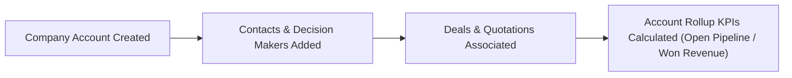

# Companies (Accounts) Management Module (MOD-04)

**Last Updated:** 2026-11-17  
**Implementation Status:** `Proposed (0% Implemented — Greenfield Specification)`  
**Related Docs:** `PROJECT_STATUS.md`, `docs/database/database-design.md`, `docs/security/role-permission-matrix.md`

## 1. Business Objectives

Manage B2B client organizations, corporate hierarchies (parent company and subsidiaries), industry classifications, billing/shipping addresses, and aggregated account pipeline value.

## 2. Implementation Status Separation

### 2.1 Existing / Implemented Functionality
- None (`0% Implemented` — Greenfield repository).

### 2.2 Proposed Functionality
- Company CRUD with industry, size tier, annual revenue, registration number, and billing/shipping addresses.
- Self-referencing parent-subsidiary hierarchy (`parent_company_id`) with cycle detection.
- Aggregated Account Rollup Metrics (total open pipeline value, total won revenue, active contacts count).
- Deletion guard (`RESTRICT`) preventing deletion of companies with open or won deals.

## 3. Functional Requirements & User Workflows



## 4. Permissions & Access Control

| Permission Slug | Authorized Roles |
| :--- | :--- |
| `companies.view.own` | Sales Rep, Sales Manager, Org Admin, Super Admin, Read-Only Analyst |
| `companies.view.team` | Sales Manager, Org Admin, Super Admin, Read-Only Analyst |
| `companies.create` | Sales Rep, Sales Manager, Org Admin, Super Admin |
| `companies.update.own` | Sales Rep, Sales Manager, Org Admin, Super Admin |
| `companies.delete` | Sales Manager, Org Admin, Super Admin |

## 5. Business Rules

- A company cannot set `parent_company_id` to its own `id` or to one of its own descendants (circular hierarchy prevention).
- A company with existing `deals` or `quotations` cannot be deleted until those records are reassigned or archived.
- `annual_revenue` is stored as `DECIMAL(15,2)`.

## 6. Database Entities

- **Primary Schema:** `companies` table (`id`, `team_id`, `owner_id`, `parent_company_id`, `name`, `registration_number`, `industry`, `company_size`, `annual_revenue`, `website`, `phone`, `billing_address`, `shipping_address`, `city`, `country`, `timestamps`, `softDeletes`).
- See `docs/database/migrations-and-indexes.md` for composite indexes and foreign key constraints.

## 7. Eloquent Relationships

- `Company::parentCompany()` -> `BelongsTo(Company::class, 'parent_company_id')`
- `Company::subsidiaries()` -> `HasMany(Company::class, 'parent_company_id')`
- `Company::contacts()` -> `HasMany(Contact::class)`
- `Company::deals()` -> `HasMany(Deal::class)`
- `Company::quotations()` -> `HasMany(Quotation::class)`
- `Company::activities()`, `Company::tasks()`, `Company::followUps()` -> `MorphMany`

## 8. Input Validation Rules (`FormRequest`)

```php
// app/Http/Requests/Companies/StoreCompanyRequest.php
public function rules(): array
{
    return [
        'name' => ['required', 'string', 'max:191'],
        'parent_company_id' => ['nullable', 'integer', 'different:id', Rule::exists('companies', 'id')->where('team_id', $this->user()->team_id)],
        'registration_number' => ['nullable', 'string', 'max:80'],
        'industry' => ['nullable', 'string', 'max:100'],
        'company_size' => ['nullable', 'string', 'max:50'],
        'annual_revenue' => ['nullable', 'numeric', 'min:0', 'max:9999999999999.99'],
        'website' => ['nullable', 'url', 'max:255'],
        'phone' => ['nullable', 'string', 'max:30'],
        'billing_address' => ['nullable', 'string', 'max:1000'],
        'shipping_address' => ['nullable', 'string', 'max:1000'],
        'city' => ['nullable', 'string', 'max:100'],
        'country' => ['required', 'string', 'size:2'],
    ];
}
```

## 9. Edge Cases & Concurrency Handling

- Circular parent-child assignment (`A -> B -> A`): validated in `UpdateCompanyRequest` by walking the ancestor chain (max depth 5).
- Attempting to delete a Company that has active Deals: gracefully caught and returns a user-friendly `422`/`409` flash message explaining that linked deals must be removed first.

## 10. Error Scenarios & HTTP Responses

- `422 Unprocessable Entity`: Circular `parent_company_id` or invalid URL/revenue format.
- `409 Conflict`: Cannot delete company with active deals or quotations.

## 11. UI & Frontend Requirements (Blade + Tailwind CSS v4)

Company directory with industry/city filters and Account Overview page (`resources/views/pages/companies/show.blade.php`) featuring KPI summary cards (`Total Won Revenue`, `Open Pipeline`, `Contacts Count`, `Subsidiaries`) and tabbed lists.

## 12. Automated Test Scenarios (Pest / PHPUnit)

- `test('company can be created with valid parent company in same team')`
- `test('circular parent_company_id hierarchy is rejected with 422')`
- `test('company with existing deals cannot be deleted')`
