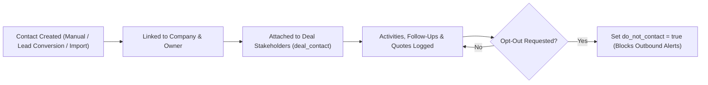

# Contacts Management Module (MOD-03)

**Last Updated:** 2026-11-19  
**Implementation Status:** `Implemented (Production Ready — Verified by PHPUnit & Pint)`  
**Related Docs:** `PROJECT_STATUS.md`, `docs/database/database-design.md`, `docs/security/role-permission-matrix.md`

## 1. Business Objectives

Maintain a unified, deduplicated directory of individual customer stakeholders, decision-makers, and influencers linked to Companies and Deals, including communication preferences (`do_not_contact`).

## 2. Implementation Summary

### 2.1 Implemented Functionality
- Contact CRUD with primary company association and stakeholder role tagging.
- Decision-maker flag (`is_primary_decision_maker`) and communication opt-out enforcement (`do_not_contact`).
- Many-to-many deal association (`deal_contact` pivot with `role` such as `Champion`, `Economic Buyer`, `Technical Evaluator`, `Legal`).
- Unified 360-degree contact profile showing linked Company, active Deals, Quotations, Activities, Tasks, and Follow-Ups.

## 3. Functional Requirements & User Workflows



## 4. Permissions & Access Control

| Permission Slug | Authorized Roles |
| :--- | :--- |
| `contacts.view.own` | Sales Rep, Sales Manager, Org Admin, Super Admin, Read-Only Analyst |
| `contacts.view.team` | Sales Manager, Org Admin, Super Admin, Read-Only Analyst |
| `contacts.create` | Sales Rep, Sales Manager, Org Admin, Super Admin |
| `contacts.update.own` | Sales Rep, Sales Manager, Org Admin, Super Admin |
| `contacts.delete` | Sales Manager, Org Admin, Super Admin |

## 5. Business Rules

- Email addresses within the same `team_id` should warn or block accidental duplicate creation.
- When `do_not_contact = true`, the UI displays a high-visibility warning banner and blocks automated outbound email/follow-up scheduling for that contact.
- Deleting a contact that is referenced as `deals.primary_contact_id` sets `primary_contact_id = NULL` on the deal (`nullOnDelete`) without deleting the deal.

## 6. Database Entities

- **Primary Schema:** `contacts` table (`id`, `team_id`, `owner_id`, `company_id`, `first_name`, `last_name`, `email`, `phone`, `mobile`, `job_title`, `department`, `is_primary_decision_maker`, `do_not_contact`, `lead_source`, `timestamps`, `softDeletes`) and `deal_contact` pivot (`deal_id`, `contact_id`, `role`, `is_primary`).
- See `docs/database/migrations-and-indexes.md` for composite indexes and foreign key constraints.

## 7. Eloquent Relationships

- `Contact::company()` -> `BelongsTo(Company::class)`
- `Contact::owner()` -> `BelongsTo(User::class, 'owner_id')`
- `Contact::deals()` -> `BelongsToMany(Deal::class, 'deal_contact')->withPivot(['role', 'is_primary'])`
- `Contact::quotations()` -> `HasMany(Quotation::class)`
- `Contact::activities()`, `Contact::tasks()`, `Contact::followUps()` -> `MorphMany`

## 8. Input Validation Rules (`FormRequest`)

```php
// app/Http/Requests/Contacts/StoreContactRequest.php
public function rules(): array
{
    return [
        'company_id' => ['nullable', 'integer', Rule::exists('companies', 'id')->where('team_id', $this->user()->team_id)],
        'first_name' => ['required', 'string', 'max:100'],
        'last_name' => ['required', 'string', 'max:100'],
        'email' => ['nullable', 'email:rfc', 'max:191'],
        'phone' => ['nullable', 'string', 'max:30'],
        'mobile' => ['nullable', 'string', 'max:30'],
        'job_title' => ['nullable', 'string', 'max:120'],
        'department' => ['nullable', 'string', 'max:100'],
        'is_primary_decision_maker' => ['boolean'],
        'do_not_contact' => ['boolean'],
    ];
}
```

## 9. Edge Cases & Concurrency Handling

- Assigning a Contact to a `company_id` belonging to another team: blocked by `Rule::exists('companies', 'id')->where('team_id', ...)`.
- Independent B2C consultant contact with no company: `company_id` is nullable.
- Merging duplicate contacts: re-points `deals`, `quotations`, `activities`, and `tasks` to the surviving `contact_id` inside `DB::transaction()`.

## 10. Error Scenarios & HTTP Responses

- `422 Unprocessable Entity`: Invalid `company_id` or missing `first_name` / `last_name`.
- `403 Forbidden`: Accessing a contact outside the user's team/ownership scope.

## 11. UI & Frontend Requirements (Blade + Tailwind CSS v4)

Two-column 360-degree Contact Show page (`resources/views/pages/contacts/show.blade.php`): left sidebar with contact card, company link, decision-maker badge, and `do_not_contact` status; right column with tabbed Timeline, Deals, Quotations, and Tasks.

## 12. Automated Test Scenarios (Pest / PHPUnit)

- `test('contact can be created and linked to a same-team company')`
- `test('contact cannot be linked to a company from another team')`
- `test('do_not_contact flag blocks scheduling automated outbound follow-up emails')`
- `test('soft-deleting a contact preserves associated deals')`
