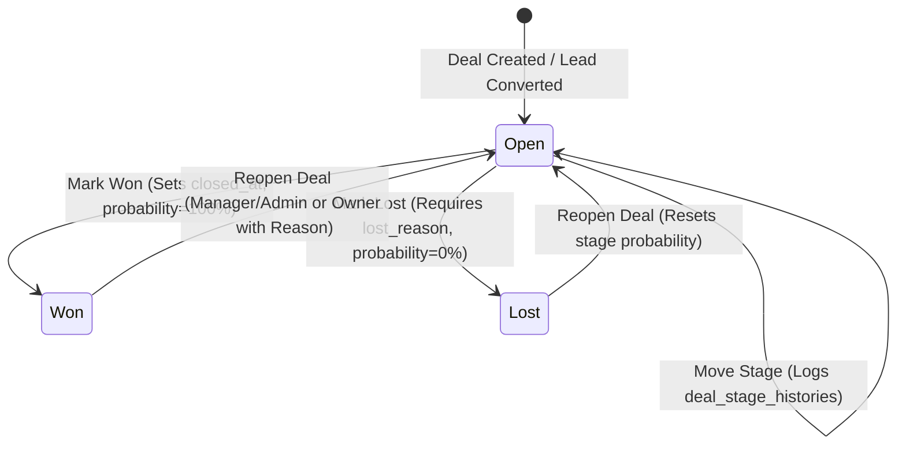

# Deals & Opportunities Module (MOD-06)

**Last Updated:** 2026-11-19  
**Implementation Status:** `Implemented (Production Ready — Verified by PHPUnit & Pint)`  
**Related Docs:** `PROJECT_STATUS.md`, `docs/database/database-design.md`, `docs/security/role-permission-matrix.md`

## 1. Business Objectives

Track revenue-generating sales opportunities from qualification through closing, recording stage transition velocity, weighted forecast values, stakeholder roles, and win/loss intelligence.

## 2. Implementation Summary

### 2.1 Implemented Functionality
- Deal CRUD with valuation (`DECIMAL(15,2)`), currency, expected close date, and custom probability override.
- Drag-and-drop and one-click stage transitions (`MoveDealStageAction`) logging exact dwell time in `deal_stage_histories`.
- Mandatory `lost_reason` (and optional `lost_competitor`) when marking a deal as `lost`.
- Automatic sync of deal value when a linked Quotation is marked `accepted`.
- Deal rotting detection when no activity or stage movement occurs within the stage's `rotting_days` window.

## 3. Functional Requirements & User Workflows



## 4. Permissions & Access Control

| Permission Slug | Authorized Roles |
| :--- | :--- |
| `deals.view.own` | Sales Rep, Sales Manager, Org Admin, Super Admin, Read-Only Analyst |
| `deals.view.team` | Sales Manager, Org Admin, Super Admin, Read-Only Analyst |
| `deals.create` | Sales Rep, Sales Manager, Org Admin, Super Admin |
| `deals.update.own` | Sales Rep, Sales Manager, Org Admin, Super Admin |
| `deals.move_stage.own` | Sales Rep, Sales Manager, Org Admin, Super Admin |
| `deals.delete` | Sales Manager, Org Admin, Super Admin |

## 5. Business Rules

- Weighted deal value is computed as `ROUND(value * (probability / 100), 2)`.
- Moving a deal to a stage where `is_won_stage = true` automatically sets `status = 'won'`, `probability = 100.00`, and `closed_at = now()`.
- Moving a deal to a stage where `is_lost_stage = true` or marking `status = 'lost'` requires a non-empty `lost_reason` and sets `probability = 0.00` and `closed_at = now()`.
- Every stage transition appends an immutable row to `deal_stage_histories` recording `duration_in_previous_stage_seconds`.

## 6. Database Entities

- **Primary Schema:** `deals` (`id`, `team_id`, `owner_id`, `pipeline_id`, `pipeline_stage_id`, `company_id`, `primary_contact_id`, `title`, `value`, `currency`, `probability`, `status`, `expected_close_date`, `closed_at`, `won_notes`, `lost_reason`, `lost_competitor`, `stage_changed_at`, `last_activity_at`, `timestamps`, `softDeletes`), `deal_contact`, and `deal_stage_histories`.
- See `docs/database/migrations-and-indexes.md` for composite indexes and foreign key constraints.

## 7. Eloquent Relationships

- `Deal::pipeline()` -> `BelongsTo(Pipeline::class)`
- `Deal::stage()` -> `BelongsTo(PipelineStage::class, 'pipeline_stage_id')`
- `Deal::company()` -> `BelongsTo(Company::class)`
- `Deal::primaryContact()` -> `BelongsTo(Contact::class, 'primary_contact_id')`
- `Deal::contacts()` -> `BelongsToMany(Contact::class, 'deal_contact')`
- `Deal::stageHistories()` -> `HasMany(DealStageHistory::class)`
- `Deal::quotations()` -> `HasMany(Quotation::class)`
- `Deal::activities()`, `Deal::tasks()`, `Deal::followUps()`, `Deal::attachments()` -> `MorphMany`

## 8. Input Validation Rules (`FormRequest`)

```php
// app/Http/Requests/Deals/StoreDealRequest.php
public function rules(): array
{
    return [
        'title' => ['required', 'string', 'max:191'],
        'company_id' => ['required', 'integer', Rule::exists('companies', 'id')->where('team_id', $this->user()->team_id)],
        'primary_contact_id' => ['nullable', 'integer', Rule::exists('contacts', 'id')->where('team_id', $this->user()->team_id)],
        'pipeline_id' => ['required', 'integer', 'exists:pipelines,id'],
        'pipeline_stage_id' => [
            'required',
            'integer',
            Rule::exists('pipeline_stages', 'id')->where('pipeline_id', $this->input('pipeline_id')),
        ],
        'value' => ['required', 'numeric', 'min:0', 'max:9999999999999.99'],
        'currency' => ['required', 'string', 'size:3'],
        'probability' => ['nullable', 'numeric', 'min:0', 'max:100'],
        'expected_close_date' => ['nullable', 'date'],
        'lost_reason' => ['nullable', 'required_if:status,lost', 'string', 'max:150'],
    ];
}
```

## 9. Edge Cases & Concurrency Handling

- Assigning a `pipeline_stage_id` that belongs to a different `pipeline_id`: blocked by scoped `Rule::exists('pipeline_stages', 'id')->where('pipeline_id', ...)`.
- Drag-and-drop stage move fails on network error or `403`: Vanilla JS `kanban.js` catches non-2xx response, snaps the card back to its original column, and displays an error toast.

## 10. Error Scenarios & HTTP Responses

- `422 Unprocessable Entity`: Marking deal lost without `lost_reason` or mismatched `pipeline_stage_id`.
- `403 Forbidden`: Moving or editing another rep's deal without team manager permissions.

## 11. UI & Frontend Requirements (Blade + Tailwind CSS v4)

Deal Workspace View (`resources/views/pages/deals/show.blade.php`) featuring horizontal interactive stage chevron bar at top, left summary panel (value, weighted value, expected close, company, stakeholders), and center unified Activity/Task/Quotation tabs.

## 12. Automated Test Scenarios (Pest / PHPUnit)

- `test('creating a deal sets initial stage probability and logs initial stage history')`
- `test('moving deal stage records duration in deal_stage_histories')`
- `test('marking deal as lost requires lost_reason and sets probability to 0')`
- `test('stage_id from another pipeline is rejected with 422')`
