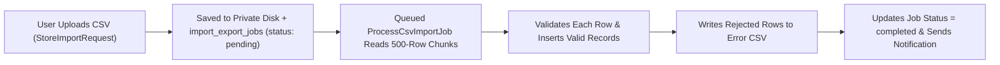

# Data Import & Export Module (MOD-13)

**Last Updated:** 2026-11-17  
**Implementation Status:** `Proposed (0% Implemented — Greenfield Specification)`  
**Related Docs:** `PROJECT_STATUS.md`, `docs/database/database-design.md`, `docs/security/role-permission-matrix.md`

## 1. Business Objectives

Provide safe, asynchronous, chunked CSV/XLSX bulk importing and exporting for Leads, Contacts, Companies, and Deals with row-level validation, formula-injection sanitization, and audit logging.

## 2. Implementation Status Separation

### 2.1 Existing / Implemented Functionality
- None (`0% Implemented` — Greenfield repository).

### 2.2 Proposed Functionality
- Upload CSV/XLSX files to private storage (`storage/app/private/imports/`) and process asynchronously via `ProcessCsvImportJob`.
- Row-by-row validation in 500-row chunks recording `processed_rows`, `failed_rows`, and downloadable error CSV reports.
- Scoped data export (`GenerateExportFileJob`) respecting `visibleTo($user)` and logging every export to `audit_logs`.
- CSV Formula Injection neutralization (prefixing cells starting with `=`, `+`, `-`, `@` with a single quote or stripping).

## 3. Functional Requirements & User Workflows



## 4. Permissions & Access Control

| Permission Slug | Authorized Roles |
| :--- | :--- |
| `imports.create` | Sales Manager, Org Admin, Super Admin |
| `exports.create.own` | Sales Rep (if enabled), Sales Manager, Org Admin, Super Admin |
| `exports.create.all` | Org Admin, Super Admin |

## 5. Business Rules

- Maximum upload size is `10 MB` (`max:10240`) and strictly restricted to `.csv` / `.xlsx` MIME types.
- Imports never abort the entire file on a single bad row; valid rows are committed and invalid rows are collected with line numbers and error messages.
- Every export operation must apply the requesting user's `visibleTo($user)` scope so users can never export records they cannot view in the UI.
- Every export job writes an immutable entry to `audit_logs` (`event = 'exported'`).

## 6. Database Entities

- **Primary Schema:** `import_export_jobs` (`id`, `team_id`, `user_id`, `type`, `module`, `status`, `file_disk`, `source_file_path`, `result_file_path`, `total_rows`, `processed_rows`, `failed_rows`, `error_summary`, `started_at`, `completed_at`, `timestamps`).
- See `docs/database/migrations-and-indexes.md` for composite indexes and foreign key constraints.

## 7. Eloquent Relationships

- `ImportExportJob::user()` -> `BelongsTo(User::class)`
- `ImportExportJob::team()` -> `BelongsTo(Team::class)`

## 8. Input Validation Rules (`FormRequest`)

```php
// app/Http/Requests/Imports/StoreImportRequest.php
public function rules(): array
{
    return [
        'module' => ['required', Rule::in(['leads', 'contacts', 'companies'])],
        'file' => [
            'required',
            'file',
            'max:10240', // 10 MB
            'mimes:csv,txt,xlsx',
        ],
        'duplicate_strategy' => ['required', Rule::in(['skip', 'update'])],
    ];
}
```

## 9. Edge Cases & Concurrency Handling

- CSV Formula Injection (`=CMD|' /C calc'!A0`): sanitized on both import and export via `CsvSanitizer::sanitizeCell($value)`.
- UTF-8 BOM or malformed encoding in uploaded CSV: normalized to UTF-8 and stripped of BOM header before header mapping.

## 10. Error Scenarios & HTTP Responses

- `422 Unprocessable Entity`: Invalid MIME type, file > 10 MB, or missing required CSV header columns.
- `403 Forbidden`: Sales Rep attempting bulk import or unauthorized full-database export.

## 11. UI & Frontend Requirements (Blade + Tailwind CSS v4)

Import/Export Center (`resources/views/pages/imports/index.blade.php`) with sample CSV template download links, drag-and-drop upload zone, job progress table (`pending`, `processing`, `completed`, `failed`), and downloadable Error Report link.

## 12. Automated Test Scenarios (Pest / PHPUnit)

- `test('valid csv import queues job and inserts leads while logging failed rows')`
- `test('csv export only includes records visible to the requesting user')`
- `test('csv export escapes cells starting with equals sign to prevent formula injection')`
- `test('every export creates an audit_logs entry')`
