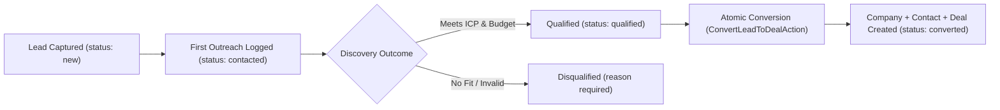

# Leads Management Module (MOD-02)

**Last Updated:** 2026-11-19  
**Implementation Status:** `Implemented (Production Ready — Verified by PHPUnit & Pint)`  
**Related Docs:** `PROJECT_STATUS.md`, `docs/database/database-design.md`, `docs/security/role-permission-matrix.md`

## 1. Business Objectives

Capture, deduplicate, score, qualify, and atomically convert inbound and outbound sales prospects into structured Company, Contact, and Deal records without losing historical activity context.

## 2. Implementation Summary

### 2.1 Implemented Functionality
- Manual lead creation, web-to-lead webhook ingestion, and bulk CSV import.
- Lead status lifecycle (`new` -> `contacted` -> `qualified` -> `converted` or `disqualified`).
- Rule-based lead score calculation (`0–100`) and duplicate detection by email/phone.
- Atomic conversion modal (`ConvertLeadToDealAction`) creating/linking Company, Contact, and optional Deal inside a single database transaction.
- Polymorphic migration/linking of activities, tasks, and follow-ups upon conversion.

## 3. Functional Requirements & User Workflows



## 4. Permissions & Access Control

| Permission Slug | Authorized Roles |
| :--- | :--- |
| `leads.view.own` | Sales Rep, Sales Manager, Org Admin, Super Admin, Read-Only Analyst |
| `leads.view.team` | Sales Manager, Org Admin, Super Admin, Read-Only Analyst |
| `leads.create` | Sales Rep, Sales Manager, Org Admin, Super Admin |
| `leads.update.own` | Sales Rep, Sales Manager, Org Admin, Super Admin |
| `leads.convert` | Sales Rep (own), Sales Manager (team), Org Admin, Super Admin |
| `leads.delete` | Sales Manager (team), Org Admin, Super Admin |

## 5. Business Rules

- A lead with `status = converted` is read-only and cannot be edited or converted a second time.
- Transitioning a lead to `disqualified` requires a non-empty `disqualified_reason`.
- Converting a lead checks if a `Company` (by exact case-insensitive `name` within `team_id`) or `Contact` (by `email` within `team_id`) already exists; if found, the user can link to the existing record instead of creating a duplicate.
- Lead score must remain bounded between `0` and `100`.

## 6. Database Entities

- **Primary Schema:** `leads` table (`id`, `team_id`, `owner_id`, `first_name`, `last_name`, `company_name`, `job_title`, `email`, `phone`, `website`, `source`, `status`, `score`, `estimated_value`, `disqualified_reason`, `converted_at`, `converted_by_id`, `converted_company_id`, `converted_contact_id`, `converted_deal_id`, `last_contacted_at`, `timestamps`, `softDeletes`).
- See `docs/database/migrations-and-indexes.md` for composite indexes and foreign key constraints.

## 7. Eloquent Relationships

- `Lead::owner()` -> `BelongsTo(User::class, 'owner_id')`
- `Lead::team()` -> `BelongsTo(Team::class)`
- `Lead::convertedCompany()` -> `BelongsTo(Company::class, 'converted_company_id')`
- `Lead::convertedContact()` -> `BelongsTo(Contact::class, 'converted_contact_id')`
- `Lead::convertedDeal()` -> `BelongsTo(Deal::class, 'converted_deal_id')`
- `Lead::activities()`, `Lead::tasks()`, `Lead::followUps()` -> `MorphMany`

## 8. Input Validation Rules (`FormRequest`)

```php
// app/Http/Requests/Leads/StoreLeadRequest.php
public function rules(): array
{
    return [
        'first_name' => ['required', 'string', 'max:100'],
        'last_name' => ['nullable', 'string', 'max:100'],
        'company_name' => ['nullable', 'string', 'max:191'],
        'job_title' => ['nullable', 'string', 'max:120'],
        'email' => ['nullable', 'email:rfc', 'max:191', 'required_without:phone'],
        'phone' => ['nullable', 'string', 'max:30', 'required_without:email'],
        'website' => ['nullable', 'url', 'max:255'],
        'source' => ['required', Rule::enum(LeadSource::class)],
        'status' => ['required', Rule::enum(LeadStatus::class)],
        'score' => ['nullable', 'integer', 'min:0', 'max:100'],
        'estimated_value' => ['nullable', 'numeric', 'min:0', 'max:9999999999999.99'],
        'disqualified_reason' => ['nullable', 'required_if:status,disqualified', 'string', 'max:255'],
    ];
}
```

## 9. Edge Cases & Concurrency Handling

- Concurrent double-click on 'Convert Lead' button: mitigated by `Lead::query()->lockForUpdate()` inside `ConvertLeadToDealAction`.
- Lead hasneither email nor phone: blocked by `required_without` validation rule.
- Converting a lead whose email already belongs to an existing `Contact`: conversion service links to existing `Contact` and appends missing phone/title fields rather than throwing a duplicate key crash.

## 10. Error Scenarios & HTTP Responses

- `422 Unprocessable Entity`: Missing both `email` and `phone`, or setting `status = disqualified` without `disqualified_reason`.
- `409 Conflict` / `DomainRuleException`: Attempting to convert or mutate an already-converted lead.
- `403 Forbidden`: Sales Rep attempting to view, edit, or convert a lead owned by another rep outside their visibility scope.

## 11. UI & Frontend Requirements (Blade + Tailwind CSS v4)

Filterable Blade index table (`resources/views/pages/leads/index.blade.php`) with status tabs (`All`, `New`, `Contacted`, `Qualified`, `Disqualified`), score badge, quick-log activity drawer, and an accessible `<dialog>` Conversion Modal (`resources/views/pages/leads/partials/convert-modal.blade.php`) styled with [Tailwind CSS v4](https://tailwindcss.com/docs/upgrade-guide).

## 12. Automated Test Scenarios (Pest / PHPUnit)

- `test('sales rep can create a lead with valid email or phone')`
- `test('disqualifying a lead requires a disqualified reason')`
- `test('converting a qualified lead atomically creates company, contact, and deal')`
- `test('concurrent conversion of an already converted lead is rejected')`
- `test('sales rep cannot view or convert a lead from another team (IDOR check)')`
