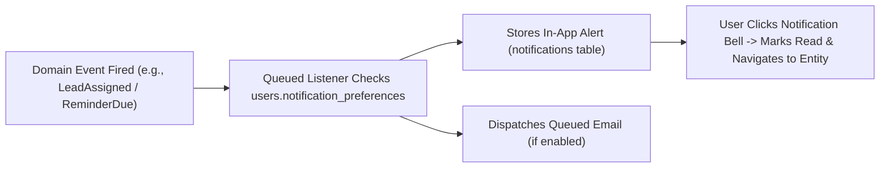

# Notifications & Real-Time Alerts Module (MOD-12)

**Last Updated:** 2026-11-19  
**Implementation Status:** `Implemented (Production Ready — Verified by PHPUnit & Pint)`  
**Related Docs:** `PROJECT_STATUS.md`, `docs/database/database-design.md`, `docs/security/role-permission-matrix.md`

## 1. Business Objectives

Keep sales reps and managers informed of time-sensitive events (lead assignment, task/follow-up reminders, deal rotting, quotation acceptance, import completion) via in-app database alerts and queued emails.

## 2. Implementation Summary

### 2.1 Implemented Functionality
- Native Laravel `notifications` table integration for in-app notification bell dropdown.
- Queued email notifications (`ShouldQueue`) for external delivery without slowing HTTP requests.
- Per-user notification preference matrix (`users.notification_preferences` JSON column) allowing users to toggle email vs in-app per event category.
- Mark single or all notifications as read via AJAX.

## 3. Functional Requirements & User Workflows



## 4. Permissions & Access Control

| Permission Slug | Authorized Roles |
| :--- | :--- |
| `notifications.view.own` | All Authenticated Roles |
| `notifications.manage_preferences.own` | All Authenticated Roles |

## 5. Business Rules

- Users can only view and mark as read notifications where `notifiable_id === $user->id` and `notifiable_type === 'user'`.
- All email notifications must implement `Illuminate\Contracts\Queue\ShouldQueue` so SMTP latency never blocks user actions.
- Deactivated users (`is_active = false`) never receive notifications.

## 6. Database Entities

- **Primary Schema:** `notifications` (`id` UUID PK, `type`, `notifiable_type`, `notifiable_id`, `data` JSON, `read_at`, `timestamps`) and `users.notification_preferences` (`JSON`).
- See `docs/database/migrations-and-indexes.md` for composite indexes and foreign key constraints.

## 7. Eloquent Relationships

- `User::notifications()` -> `MorphMany(DatabaseNotification::class, 'notifiable')`

## 8. Input Validation Rules (`FormRequest`)

```php
// app/Http/Requests/Notifications/UpdateNotificationPreferencesRequest.php
public function rules(): array
{
    return [
        'preferences' => ['required', 'array'],
        'preferences.lead_assigned' => ['required', 'array'],
        'preferences.lead_assigned.database' => ['required', 'boolean'],
        'preferences.lead_assigned.mail' => ['required', 'boolean'],
        'preferences.task_reminder' => ['required', 'array'],
        'preferences.task_reminder.database' => ['required', 'boolean'],
        'preferences.task_reminder.mail' => ['required', 'boolean'],
    ];
}
```

## 9. Edge Cases & Concurrency Handling

- SMTP server temporary failure: queued notification job retries up to 3 times with exponential backoff (`$backoff = [30, 120, 300]`) without losing the already-stored database notification.
- Deleted target Deal/Lead before user clicks notification: notification link gracefully handles `404` or redirects with a notice.

## 10. Error Scenarios & HTTP Responses

- `403 Forbidden`: Attempting to mark another user's notification as read.

## 11. UI & Frontend Requirements (Blade + Tailwind CSS v4)

Topbar Notification Bell dropdown (`resources/views/components/crm/notification-bell.blade.php`) with unread count badge, `Mark all as read` button, and Notification Preferences settings page.

## 12. Automated Test Scenarios (Pest / PHPUnit)

- `test('assigning a lead dispatches database and queued mail notification')`
- `test('user cannot mark another user notification as read')`
- `test('disabling mail channel in preferences suppresses email while keeping database alert')`
