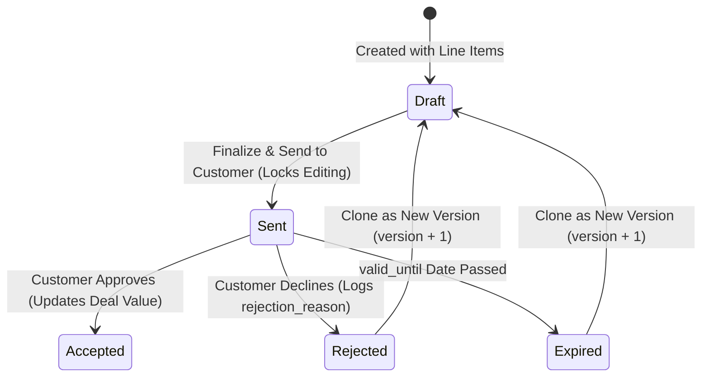

# Quotations & Proposals Module (MOD-10)

**Last Updated:** 2026-11-17  
**Implementation Status:** `Proposed (0% Implemented — Greenfield Specification)`  
**Related Docs:** `PROJECT_STATUS.md`, `docs/database/database-design.md`, `docs/security/role-permission-matrix.md`

## 1. Business Objectives

Generate accurate, versioned commercial quotations with multi-line items, discounts, taxes, terms, and printable PDF output linked directly to Deals and Companies.

## 2. Implementation Status Separation

### 2.1 Existing / Implemented Functionality
- None (`0% Implemented` — Greenfield repository).

### 2.2 Proposed Functionality
- Sequential, collision-free quote numbering (`QT-YYYY-00001`) and ULID public identifiers.
- Line-item builder (`quotation_items`) supporting quantity, unit price, line discount %, and line tax %.
- Strict server-side decimal math (`CalculateQuotationTotalsAction`) computing `subtotal`, `discount_total`, `tax_total`, and `grand_total`.
- Quotation state machine (`draft` -> `sent` -> `accepted` / `rejected` / `expired`).
- Accepting a quotation (`AcceptQuotationAction`) optionally syncs `deals.value = quotation.grand_total`.
- Clean printable Blade layout and PDF download (`QuotationPdfService`).

## 3. Functional Requirements & User Workflows



## 4. Permissions & Access Control

| Permission Slug | Authorized Roles |
| :--- | :--- |
| `quotations.view.own` | All Authenticated Roles |
| `quotations.view.team` | Sales Manager, Org Admin, Super Admin, Read-Only Analyst |
| `quotations.create` | Sales Rep, Sales Manager, Org Admin, Super Admin |
| `quotations.update.own` | Sales Rep (draft only), Sales Manager, Org Admin, Super Admin |
| `quotations.send` | Sales Rep (own), Sales Manager, Org Admin, Super Admin |
| `quotations.approve_discount` | Sales Manager, Org Admin, Super Admin (when discount > threshold) |
| `quotations.delete` | Sales Manager (draft only), Org Admin, Super Admin |

## 5. Business Rules

- Only quotations in `status = 'draft'` can have their line items edited. Once `sent`, revisions require cloning a new version (`version + 1`).
- Every quotation must contain at least 1 `quotation_items` row.
- `valid_until` must be greater than or equal to `issue_date`.
- All financial totals are recalculated on the backend inside `DB::transaction()`; client-supplied totals from JavaScript are ignored.

## 6. Database Entities

- **Primary Schema:** `quotations` (`id`, `ulid`, `team_id`, `owner_id`, `deal_id`, `company_id`, `contact_id`, `quote_number`, `version`, `status`, `currency`, `subtotal`, `discount_total`, `tax_total`, `grand_total`, `issue_date`, `valid_until`, `terms_and_conditions`, `customer_notes`, `sent_at`, `accepted_at`, `rejected_at`, `rejection_reason`, `timestamps`, `softDeletes`) and `quotation_items` (`id`, `quotation_id`, `position`, `item_name`, `description`, `quantity`, `unit`, `unit_price`, `discount_percent`, `tax_percent`, `line_total`, `timestamps`).
- See `docs/database/migrations-and-indexes.md` for composite indexes and foreign key constraints.

## 7. Eloquent Relationships

- `Quotation::deal()` -> `BelongsTo(Deal::class)`
- `Quotation::company()` -> `BelongsTo(Company::class)`
- `Quotation::contact()` -> `BelongsTo(Contact::class)`
- `Quotation::owner()` -> `BelongsTo(User::class, 'owner_id')`
- `Quotation::items()` -> `HasMany(QuotationItem::class)->orderBy('position')`

## 8. Input Validation Rules (`FormRequest`)

```php
// app/Http/Requests/Quotations/StoreQuotationRequest.php
public function rules(): array
{
    return [
        'deal_id' => ['required', 'integer', Rule::exists('deals', 'id')->where('team_id', $this->user()->team_id)],
        'contact_id' => ['nullable', 'integer', Rule::exists('contacts', 'id')->where('team_id', $this->user()->team_id)],
        'currency' => ['required', 'string', 'size:3'],
        'issue_date' => ['required', 'date'],
        'valid_until' => ['required', 'date', 'after_or_equal:issue_date'],
        'terms_and_conditions' => ['nullable', 'string', 'max:5000'],
        'customer_notes' => ['nullable', 'string', 'max:2000'],
        'items' => ['required', 'array', 'min:1'],
        'items.*.item_name' => ['required', 'string', 'max:191'],
        'items.*.description' => ['nullable', 'string', 'max:1000'],
        'items.*.quantity' => ['required', 'numeric', 'gt:0', 'max:999999.99'],
        'items.*.unit_price' => ['required', 'numeric', 'min:0', 'max:9999999999.99'],
        'items.*.discount_percent' => ['nullable', 'numeric', 'min:0', 'max:100'],
        'items.*.tax_percent' => ['nullable', 'numeric', 'min:0', 'max:100'],
    ];
}
```

## 9. Edge Cases & Concurrency Handling

- Tampered client payload submitting fake `grand_total`: server ignores any total fields in request input and computes all totals from `items` array.
- Attempting to edit a `sent` or `accepted` quotation: rejected with `409 Conflict` (`DomainRuleException`).
- Concurrent quote creation generating duplicate `quote_number`: prevented by atomic sequence generation or database lock.

## 10. Error Scenarios & HTTP Responses

- `422 Unprocessable Entity`: Empty `items` array, negative price/quantity, or `valid_until < issue_date`.
- `409 Conflict`: Mutating a non-draft quotation.

## 11. UI & Frontend Requirements (Blade + Tailwind CSS v4)

Interactive Quotation Builder (`resources/views/pages/quotations/form.blade.php`) with dynamic row addition/removal (`quotation-calculator.js`), live subtotal/discount/tax preview footer, status badge, and a print-optimized A4 view (`resources/views/pages/quotations/print.blade.php`).

## 12. Automated Test Scenarios (Pest / PHPUnit)

- `test('creating quotation calculates exact subtotal, discount, tax, and grand total on server')`
- `test('sent quotation cannot be edited directly')`
- `test('accepting a quotation updates parent deal value and logs audit event')`
- `test('cloning a rejected quotation creates draft with incremented version')`
