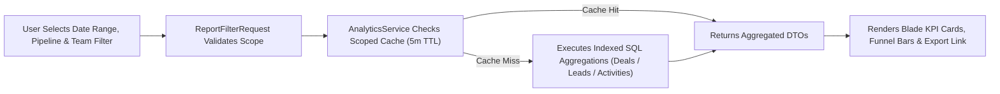

# Reports & Executive Analytics Module (MOD-11)

**Last Updated:** 2026-11-19  
**Implementation Status:** `Implemented (Production Ready — Verified by PHPUnit & Pint)`  
**Related Docs:** `PROJECT_STATUS.md`, `docs/database/database-design.md`, `docs/security/role-permission-matrix.md`

## 1. Business Objectives

Deliver real-time and cached analytical visibility into sales pipeline health, weighted revenue forecasts, lead conversion funnels, deal stage velocity, and sales rep/team performance against quota.

## 2. Implementation Summary

### 2.1 Implemented Functionality
- Pipeline Funnel & Stage Conversion Report (count, total value, weighted value, and drop-off % per stage).
- Weighted Revenue Forecast Report grouped by `expected_close_date` month and rep/team.
- Lead Source Attribution & Conversion Rate Report (`website`, `referral`, `cold_call`, `linkedin`, `event`).
- Sales Rep & Team Quota Attainment Leaderboard (`SUM(won deals)` vs `teams.monthly_revenue_target`).
- Win/Loss Reason Breakdown & Average Sales Cycle Duration (`AVG(TIMESTAMPDIFF(DAY, created_at, closed_at))`).

## 3. Functional Requirements & User Workflows



## 4. Permissions & Access Control

| Permission Slug | Authorized Roles |
| :--- | :--- |
| `reports.view.own` | Sales Rep (own metrics only) |
| `reports.view.team` | Sales Manager (own team metrics) |
| `reports.view.all` | Org Admin, Super Admin, Read-Only Analyst |

## 5. Business Rules

- All report queries must apply `->visibleTo($user)` so a Sales Rep only sees their own performance metrics, a Sales Manager sees their team's metrics, and Admins/Analysts see organization-wide metrics.
- All aggregations (`SUM`, `COUNT`, `AVG`) execute in SQL via `GROUP BY`—never by loading thousands of Eloquent models into memory.
- Date range filters are capped at a maximum window of 366 days per synchronous request to protect database CPU.

## 6. Database Entities

- **Primary Schema:** Read-optimized SQL aggregation queries over `deals`, `deal_stage_histories`, `leads`, `activities`, `quotations`, and `teams`.
- See `docs/database/migrations-and-indexes.md` for composite indexes and foreign key constraints.

## 7. Eloquent Relationships

- Aggregates `Deal` by `pipeline_stage_id`, `owner_id`, `team_id`, and `status`.
- Aggregates `Lead` by `source` and `status`.

## 8. Input Validation Rules (`FormRequest`)

```php
// app/Http/Requests/Reports/ReportFilterRequest.php
public function rules(): array
{
    return [
        'date_from' => ['required', 'date'],
        'date_to' => ['required', 'date', 'after_or_equal:date_from'],
        'pipeline_id' => ['nullable', 'integer', 'exists:pipelines,id'],
        'team_id' => ['nullable', 'integer', 'exists:teams,id'],
        'owner_id' => ['nullable', 'integer', 'exists:users,id'],
    ];
}
```

## 9. Edge Cases & Concurrency Handling

- Division by zero when calculating win rate or conversion rate on empty datasets: guarded with `nullif` / PHP zero-denominator checks returning `0.00%`.
- Multi-currency deals in forecast totals: grouped by `currency` or converted via configured base currency rate.

## 10. Error Scenarios & HTTP Responses

- `422 Unprocessable Entity`: `date_to` earlier than `date_from` or range exceeding 366 days.
- `403 Forbidden`: Sales Rep passing another user's `owner_id` or `team_id` in query parameters.

## 11. UI & Frontend Requirements (Blade + Tailwind CSS v4)

Executive Dashboard & Reports Suite (`resources/views/pages/reports/index.blade.php`) using semantic [Tailwind CSS v4](https://tailwindcss.com/docs/upgrade-guide) KPI stat cards, CSS grid funnel bars, and tabular breakdowns.

## 12. Automated Test Scenarios (Pest / PHPUnit)

- `test('weighted forecast report matches sum of deal value times probability')`
- `test('sales rep cannot query report metrics for another rep or team')`
- `test('empty date range returns zeroed KPI structure without division by zero error')`
