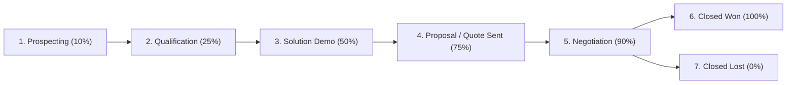

# Sales Pipeline Configuration Module (MOD-05)

**Last Updated:** 2026-11-19  
**Implementation Status:** `Implemented (Production Ready — Verified by PHPUnit & Pint)`  
**Related Docs:** `PROJECT_STATUS.md`, `docs/database/database-design.md`, `docs/security/role-permission-matrix.md`

## 1. Business Objectives

Provide configurable multi-stage sales pipelines with deterministic stage ordering, default win probabilities (`0–100%`), deal rotting thresholds, and interactive Kanban board rendering.

## 2. Implementation Summary

### 2.1 Implemented Functionality
- Multiple named pipelines per organization/team (e.g., `B2B Enterprise Pipeline`, `SMB Fast-Track`).
- Ordered `pipeline_stages` (`position`, `default_probability`, `rotting_days`, `is_won_stage`, `is_lost_stage`).
- Atomic stage reordering (`ReorderPipelineStagesAction`) avoiding unique-constraint collisions on `(pipeline_id, position)`.
- Stage deletion migration wizard requiring existing deals in a retiring stage to be reassigned to a target stage before deletion.

## 3. Functional Requirements & User Workflows



## 4. Permissions & Access Control

| Permission Slug | Authorized Roles |
| :--- | :--- |
| `pipelines.view` | All Authenticated Roles |
| `pipelines.manage` | Org Admin, Super Admin |

## 5. Business Rules

- Every active pipeline must have at least 1 open stage, exactly 1 `is_won_stage = true` (`default_probability = 100.00`), and exactly 1 `is_lost_stage = true` (`default_probability = 0.00`).
- Exactly one pipeline per team (or organization) is marked `is_default = true`.
- A stage containing deals cannot be deleted without specifying a `reassign_to_stage_id` in the same pipeline.

## 6. Database Entities

- **Primary Schema:** `pipelines` (`id`, `team_id`, `name`, `is_default`, `is_active`, `timestamps`, `softDeletes`) and `pipeline_stages` (`id`, `pipeline_id`, `name`, `slug`, `position`, `default_probability`, `rotting_days`, `is_won_stage`, `is_lost_stage`, `color`, `timestamps`, `softDeletes`).
- See `docs/database/migrations-and-indexes.md` for composite indexes and foreign key constraints.

## 7. Eloquent Relationships

- `Pipeline::stages()` -> `HasMany(PipelineStage::class)->orderBy('position')`
- `Pipeline::deals()` -> `HasMany(Deal::class)`
- `PipelineStage::pipeline()` -> `BelongsTo(Pipeline::class)`
- `PipelineStage::deals()` -> `HasMany(Deal::class, 'pipeline_stage_id')`

## 8. Input Validation Rules (`FormRequest`)

```php
// app/Http/Requests/Pipelines/StorePipelineStageRequest.php
public function rules(): array
{
    return [
        'name' => ['required', 'string', 'max:100'],
        'default_probability' => ['required', 'numeric', 'min:0', 'max:100'],
        'rotting_days' => ['required', 'integer', 'min:1', 'max:365'],
        'color' => ['required', 'string', Rule::in(['slate', 'blue', 'cyan', 'amber', 'emerald', 'rose', 'indigo'])],
        'is_won_stage' => ['boolean'],
        'is_lost_stage' => ['boolean'],
    ];
}
```

## 9. Edge Cases & Concurrency Handling

- Reordering stages when `(pipeline_id, position)` has a unique index: performed inside `DB::transaction()` using temporary negative offset positions or two-pass updates.
- Attempting to delete the last remaining default pipeline: blocked by domain rule.

## 10. Error Scenarios & HTTP Responses

- `422 Unprocessable Entity`: Setting both `is_won_stage` and `is_lost_stage` to `true` on the same stage.
- `409 Conflict`: Deleting a stage that still holds deals without providing a valid `reassign_to_stage_id`.

## 11. UI & Frontend Requirements (Blade + Tailwind CSS v4)

Pipeline Kanban View (`resources/views/pages/pipelines/kanban.blade.php`) with horizontal scrollable stage columns, column header count + total/weighted value badges, rotting indicator pills (amber/red when `now()->diffInDays(stage_changed_at) >= rotting_days`), and Admin Stage Configuration settings page.

## 12. Automated Test Scenarios (Pest / PHPUnit)

- `test('org admin can create pipeline with ordered stages')`
- `test('reordering stages updates positions atomically without unique constraint violation')`
- `test('deleting a stage with deals requires target reassignment stage')`
- `test('sales rep cannot modify pipeline stage configuration (403)')`
