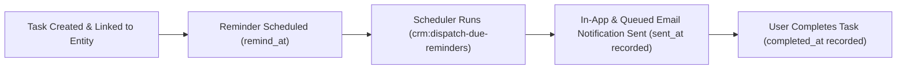

# Tasks & Reminders Module (MOD-07)

**Last Updated:** 2026-11-19  
**Implementation Status:** `Implemented (Production Ready — Verified by PHPUnit & Pint)`  
**Related Docs:** `PROJECT_STATUS.md`, `docs/database/database-design.md`, `docs/security/role-permission-matrix.md`

## 1. Business Objectives

Enable sales reps and managers to assign, prioritize, track, and receive timely automated reminders for actionable tasks linked polymorphically to any Lead, Contact, Company, or Deal.

## 2. Implementation Summary

### 2.1 Implemented Functionality
- Polymorphic task creation (`taskable_type`, `taskable_id`) with priority (`low`, `medium`, `high`, `urgent`) and status (`pending`, `in_progress`, `completed`, `cancelled`).
- Task assignment across team members with instant assignee notification.
- Configurable reminders (`reminders` table) dispatched via Laravel Scheduler (`crm:dispatch-due-reminders`) every minute.
- Grouped task views (`Overdue`, `Due Today`, `Upcoming`, `Completed`).

## 3. Functional Requirements & User Workflows



## 4. Permissions & Access Control

| Permission Slug | Authorized Roles |
| :--- | :--- |
| `tasks.view.own` | All Authenticated Roles |
| `tasks.view.team` | Sales Manager, Org Admin, Super Admin |
| `tasks.create` | Sales Rep, Sales Manager, Org Admin, Super Admin |
| `tasks.assign.team` | Sales Manager, Org Admin, Super Admin |
| `tasks.update.own` | Sales Rep, Sales Manager, Org Admin, Super Admin |
| `tasks.delete` | Sales Manager, Org Admin, Super Admin |

## 5. Business Rules

- A Sales Rep can assign tasks to themselves; assigning tasks to other users requires `tasks.assign.team` permission (Sales Manager or above).
- Completing a task sets `status = 'completed'`, `completed_at = now()`, and cancels any unsent future `reminders` (`sent_at = null`) for that task.
- Reminder dispatch is idempotent: the scheduler locks unsent due reminders and sets `sent_at = now()` so duplicate alerts are never sent.

## 6. Database Entities

- **Primary Schema:** `tasks` (`id`, `team_id`, `assigned_to_id`, `created_by_id`, `taskable_type`, `taskable_id`, `title`, `description`, `priority`, `status`, `due_at`, `completed_at`, `timestamps`, `softDeletes`) and `reminders` (`id`, `user_id`, `remindable_type`, `remindable_id`, `remind_at`, `channel`, `sent_at`, `timestamps`).
- See `docs/database/migrations-and-indexes.md` for composite indexes and foreign key constraints.

## 7. Eloquent Relationships

- `Task::taskable()` -> `MorphTo()` (`lead`, `contact`, `company`, `deal`)
- `Task::assignee()` -> `BelongsTo(User::class, 'assigned_to_id')`
- `Task::creator()` -> `BelongsTo(User::class, 'created_by_id')`
- `Task::reminders()` -> `MorphMany(Reminder::class, 'remindable')`

## 8. Input Validation Rules (`FormRequest`)

```php
// app/Http/Requests/Tasks/StoreTaskRequest.php
public function rules(): array
{
    return [
        'taskable_type' => ['required', 'string', Rule::in(['lead', 'contact', 'company', 'deal'])],
        'taskable_id' => ['required', 'integer'],
        'assigned_to_id' => ['required', 'integer', Rule::exists('users', 'id')->where('team_id', $this->user()->team_id)],
        'title' => ['required', 'string', 'max:191'],
        'description' => ['nullable', 'string', 'max:2000'],
        'priority' => ['required', Rule::enum(TaskPriority::class)],
        'due_at' => ['required', 'date'],
        'remind_at' => ['nullable', 'date', 'before_or_equal:due_at'],
    ];
}
```

## 9. Edge Cases & Concurrency Handling

- Task completed before its scheduled `remind_at` time: scheduler skips reminders whose parent `task.status === 'completed'`.
- User deactivated while holding open tasks: Admin/Manager bulk-reassignment action transfers pending tasks to an active rep.

## 10. Error Scenarios & HTTP Responses

- `422 Unprocessable Entity`: `remind_at` set after `due_at`, or invalid `taskable_type`.
- `403 Forbidden`: Sales Rep attempting to assign a task to another rep or attach a task to an entity they cannot view.

## 11. UI & Frontend Requirements (Blade + Tailwind CSS v4)

Task Inbox page (`resources/views/pages/tasks/index.blade.php`) with priority badges (`urgent` in rose, `high` in amber), one-click checkbox completion via AJAX, and inline task creation widget inside Lead/Contact/Deal detail views.

## 12. Automated Test Scenarios (Pest / PHPUnit)

- `test('rep can create a task with reminder on their own deal')`
- `test('scheduler dispatches due reminder exactly once and sets sent_at')`
- `test('completing a task suppresses pending reminders')`
