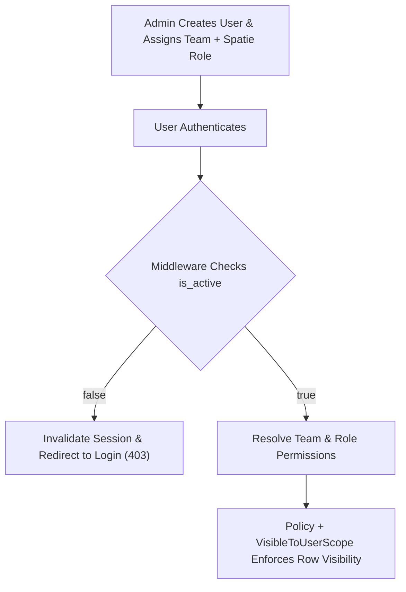

# Users, Sales Teams & Permissions (RBAC) Module (MOD-01)

**Last Updated:** 2026-11-19  
**Implementation Status:** `Implemented (Production Ready — Verified by PHPUnit & Pint)`  
**Related Docs:** `PROJECT_STATUS.md`, `docs/database/database-design.md`, `docs/security/role-permission-matrix.md`

## 1. Business Objectives

Govern user identity, sales team membership, monthly revenue targets, role-based access control (RBAC), and strict record-level data visibility across the CRM.

## 2. Implementation Summary

### 2.1 Implemented Functionality
- Five canonical CRM roles powered by [Spatie Laravel Permission](https://spatie.be/docs/laravel-permission/v8/installation-laravel): `Super Admin`, `Org Admin`, `Sales Manager`, `Sales Rep`, and `Read-Only Analyst`.
- Sales Team management (`teams` table) with `leader_id` and `monthly_revenue_target`.
- User deactivation (`is_active = false`) with immediate session invalidation and bulk record ownership transfer wizard.
- Reusable `VisibleToUserScope` trait enforcing row-level security (`own` vs `team` vs `all`).

## 3. Functional Requirements & User Workflows



## 4. Permissions & Access Control

| Permission Slug | Authorized Roles |
| :--- | :--- |
| `users.view` | Sales Manager (team), Org Admin, Super Admin |
| `users.manage` | Org Admin, Super Admin |
| `teams.manage` | Org Admin, Super Admin |
| `roles.manage` | Super Admin |

## 5. Business Rules

- Users with commercial history (`leads`, `deals`, `quotations`, `activities`) can never be hard-deleted; they must be deactivated (`is_active = false`) and their open records reassigned.
- An `Org Admin` cannot escalate their own role or another user's role to `Super Admin`.
- A user cannot deactivate their own currently logged-in account.

## 6. Database Entities

- **Primary Schema:** `users`, `teams`, and [Spatie Laravel Permission](https://spatie.be/docs/laravel-permission/v8/installation-laravel) tables (`roles`, `permissions`, `model_has_roles`, `model_has_permissions`, `role_has_permissions`).
- See `docs/database/migrations-and-indexes.md` for composite indexes and foreign key constraints.

## 7. Eloquent Relationships

- `User::team()` -> `BelongsTo(Team::class)`
- `Team::users()` -> `HasMany(User::class)`
- `Team::leader()` -> `BelongsTo(User::class, 'leader_id')`

## 8. Input Validation Rules (`FormRequest`)

```php
// app/Http/Requests/Users/StoreUserRequest.php
public function rules(): array
{
    return [
        'name' => ['required', 'string', 'max:150'],
        'email' => ['required', 'email:rfc', 'max:191', 'unique:users,email'],
        'phone' => ['nullable', 'string', 'max:30'],
        'job_title' => ['nullable', 'string', 'max:100'],
        'team_id' => ['required', 'integer', 'exists:teams,id'],
        'role' => ['required', 'string', Rule::in(['Org Admin', 'Sales Manager', 'Sales Rep', 'Read-Only Analyst'])],
        'password' => ['required', 'confirmed', Password::min(12)->mixedCase()->numbers()->symbols()],
        'is_active' => ['boolean'],
    ];
}
```

## 9. Edge Cases & Concurrency Handling

- Deactivating a logged-in user mid-session: `EnsureUserIsActive` middleware checks `auth()->user()->is_active` on every request and logs out deactivated accounts immediately.
- Reassigning open records from a departing rep: `ReassignUserRecordsAction` transfers open `leads`, `deals`, `tasks`, and `follow_ups` inside a transaction.

## 10. Error Scenarios & HTTP Responses

- `422 Unprocessable Entity`: Weak password, duplicate email, or self-deactivation attempt.
- `403 Forbidden`: Non-admin attempting to create users or escalate roles.

## 11. UI & Frontend Requirements (Blade + Tailwind CSS v4)

Admin User & Team Directory (`resources/views/pages/settings/users/index.blade.php`) with role badge, active status toggle, team quota settings, and a `Transfer Owned Records` modal.

## 12. Automated Test Scenarios (Pest / PHPUnit)

- `test('deactivated user is immediately logged out on next request')`
- `test('org admin cannot assign super admin role')`
- `test('reassign user records action transfers open deals and leads atomically')`
