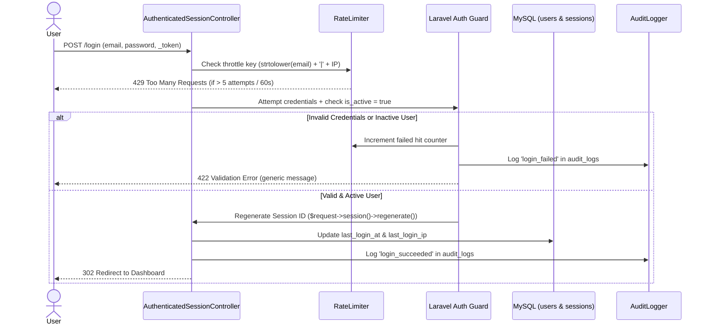

# Authentication & Session Security — Sales CRM

**Last Updated:** 2026-11-19  
**Implementation Status:** `Implemented (Active Engineering Specification)`  
**Related Docs:** `docs/security/security-policy.md`, `docs/modules/users-teams-and-permissions.md`, `docs/adr/ADR-003-authentication-and-authorization.md`

## 1. Authentication Architecture

Authentication uses Laravel's stateful `web` session guard backed by the `database` (or `redis`) session driver as configured in [Laravel 12 Configuration](https://laravel.com/framework/docs/12.x/configuration).



## 2. Password & Credential Standards

- **Hashing Algorithm:** `bcrypt` (cost factor `12`) or `argon2id` via `config/hashing.php`.
- **Password Complexity Rule:** Enforced in `AppServiceProvider` via `Password::defaults()`:
  ```php
  Password::defaults(function () {
      return Password::min(12)
          ->letters()
          ->mixedCase()
          ->numbers()
          ->symbols()
          ->uncompromised();
  });
  ```
- **Session Protection (`config/session.php`):**
  - `SESSION_DRIVER=database`
  - `SESSION_LIFETIME=120` (2 hours idle timeout)
  - `SESSION_ENCRYPT=true`
  - `SESSION_HTTP_ONLY=true` (`http_only => true` prevents JS `document.cookie` theft)
  - `SESSION_SAME_SITE=lax`
  - `SESSION_SECURE_COOKIE=true` (in production HTTPS)

## 3. Immediate Deactivation Enforcement (`EnsureUserIsActive`)

If an administrator sets `users.is_active = false`, the `EnsureUserIsActive` middleware runs on every authenticated web request:
```php
if ($request->user() && ! $request->user()->is_active) {
    Auth::guard('web')->logout();
    $request->session()->invalidate();
    $request->session()->regenerateToken();
    abort(403, 'Your account has been deactivated.');
}
```
