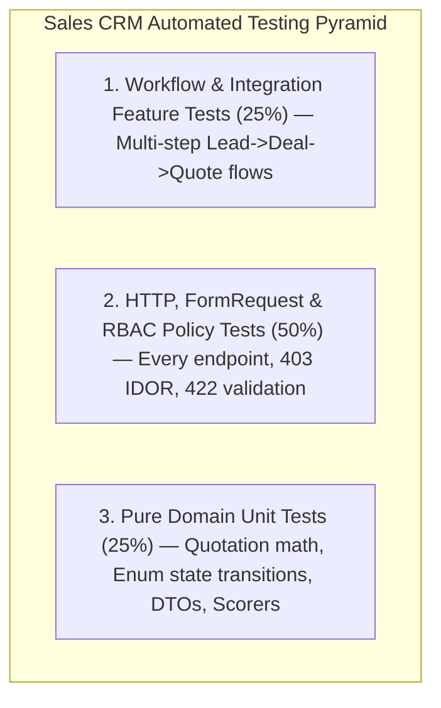

# Testing Strategy & Architecture — Sales CRM

**Last Updated:** 2026-11-19  
**Implementation Status:** `Implemented (Active Engineering Specification)`  
**Related Docs:** `docs/testing/unit-testing.md`, `docs/testing/feature-testing.md`, `docs/testing/authorization-testing.md`

## 1. Testing Philosophy

Every module in **Sales CRM** is verified using an automated test pyramid built on **[Pest PHP](https://pestphp.com/docs/writing-tests)** (or PHPUnit 11, fully compatible under the same `php artisan test` runner in [Laravel 12](https://laravel.com/framework/docs/12.x/configuration)).

## 2. Test Environment Configuration (`phpunit.xml`)

- Uses a dedicated isolated test database (`DB_DATABASE=sales_crm_testing` on MySQL 8.0+ to match production foreign key, decimal, and transaction semantics—prefer MySQL test DB over SQLite when testing `LOCK FOR UPDATE` and strict MySQL constraints).
- Uses `RefreshDatabase` (or `LazilyRefreshDatabase`) trait across all feature and database tests.
- Sets `QUEUE_CONNECTION=sync` or `Queue::fake()`, `MAIL_MAILER=array` (`Mail::fake()`), and `FILESYSTEM_DISK=local` (`Storage::fake('private')`).

## 3. Coverage & Quality Targets

| Layer | Minimum Line Coverage | Critical Requirement |
| :--- | :--- | :--- |
| Domain Actions & Financial Math (`app/Actions`, `app/Services`) | `>= 95%` | 100% branch coverage on quotation totals, lead conversion, and stage history math |
| Policies & Visibility Scopes (`app/Policies`, `app/Models/Concerns`) | `100%` | Every role (`Super Admin`, `Org Admin`, `Sales Manager`, `Sales Rep`, `Read-Only Analyst`) verified |
| Controllers & FormRequests (`app/Http`) | `>= 90%` | Guest redirect, 403 unauthorized, 422 validation, and 200/302 happy path |
