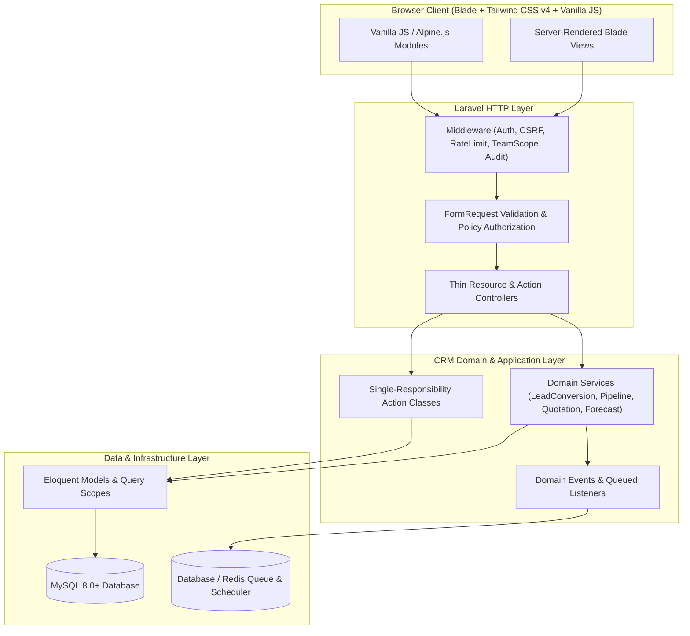

# Sales CRM — Engineering Documentation & Architecture Blueprint

**Last Updated:** 2026-11-17  
**Project Status:** `Greenfield Specification (0% Implemented / 100% Proposed)`  
**Primary Development Environment:** Google Gemini Antigravity IDE

## 1. Overview

**Sales CRM** is a modular B2B/B2C Customer Relationship Management platform engineered on [Laravel 12](https://laravel.com/framework/docs/12.x/configuration), MySQL 8.0+, Laravel Blade, [Tailwind CSS v4](https://tailwindcss.com/docs/upgrade-guide), and Vanilla JavaScript. It is designed to manage the complete revenue lifecycle—from lead capture and qualification to multi-stage pipeline tracking, quotations, customer follow-up cadences, and executive forecasting.

> **Important Status Notice:** As documented in `project-discovery-report.md` and `PROJECT_STATUS.md`, this repository currently contains the complete **engineering specification and AI development prompt system** prior to source code scaffolding. No features are implemented yet; all schemas, modules, and endpoints are marked as **Proposed**.

## 2. Technology Stack

| Category | Technology | Architectural Role |
| :--- | :--- | :--- |
| **Backend Framework** | PHP 8.3+ / [Laravel 12.x](https://laravel.com/framework/docs/12.x/configuration) | HTTP routing, FormRequest validation, Domain Services, Actions, Policies, Jobs |
| **Database & ORM** | MySQL 8.0+ / [Eloquent ORM](https://api.laravel.com/docs/12.x/index.html) | Relational persistence, foreign-key integrity, composite indexing, transactions |
| **Frontend Templating** | Laravel Blade | Server-side rendered layouts, reusable anonymous & class-based UI components |
| **Styling** | [Tailwind CSS v4](https://tailwindcss.com/docs/upgrade-guide) | CSS-first `@theme` design tokens compiled via `@tailwindcss/vite` |
| **Client Scripting** | Vanilla JS (ES2022+) / Alpine.js | Progressive enhancement, Kanban drag-and-drop, modal/drawer state |
| **Authorization** | Laravel Policies + [Spatie Permission](https://spatie.be/docs/laravel-permission/v8/installation-laravel) | Role-Based Access Control (RBAC) + record-level ownership & team scoping |
| **Testing** | [Pest PHP](https://pestphp.com/docs/writing-tests) / PHPUnit | Unit, Feature, Database, and Authorization regression testing |
| **AI Coding Workflow** | Google Gemini Antigravity IDE | Governed by `GEMINI.md` and the prompt library in `docs/prompts/` |

## 3. System Architecture Summary

## 4. Complete Documentation Index

### Root Governance Files
- `GEMINI.md` — Mandatory operating instructions and constraints for Google Gemini Antigravity IDE
- `PROJECT_STATUS.md` — Phase-by-phase implementation roadmap and module readiness matrix
- `project-discovery-report.md` — Initial repository audit and greenfield baseline verification
- `CONTRIBUTING.md` — Git workflow, branching, PR standards, and documentation sync rules
- `CHANGELOG.md` — Version history and milestone tracking
- `DOCUMENTATION_GENERATION_REPORT.md` — Summary and verification audit of this documentation system

### Architecture (`docs/architecture/`)
- `docs/architecture/system-architecture.md` — High-level layered architecture and topology
- `docs/architecture/application-structure.md` — Directory tree and namespace conventions
- `docs/architecture/backend-architecture.md` — Controllers, FormRequests, Services, Actions, Events, Jobs
- `docs/architecture/frontend-architecture.md` — Blade component hierarchy, Tailwind CSS v4 `@theme`, Vanilla JS rules
- `docs/architecture/coding-standards.md` — PHP 8.3+, strict types, PSR-12, Eloquent and Blade lint rules
- `docs/architecture/design-patterns.md` — Approved patterns (Service, Action, Policy, Observer, State) and anti-patterns
- `docs/architecture/request-lifecycle.md` — End-to-end HTTP and queued job lifecycle with sequence diagrams
- `docs/architecture/scalability-strategy.md` — Query optimization, caching, queue partitioning, horizontal scaling

### Database (`docs/database/`)
- `docs/database/database-design.md` — Naming conventions, data types, money handling, audit columns
- `docs/database/database-relationships.md` — 1:N, N:M, and polymorphic (`morphTo`) mappings across 18 tables
- `docs/database/erd.md` — Complete Mermaid Entity-Relationship Diagrams
- `docs/database/migrations-and-indexes.md` — Ordered migration execution plan and composite index specifications
- `docs/database/database-optimization.md` — N+1 prevention, `EXPLAIN` analysis, cursor pagination, summary tables
- `docs/database/data-integrity.md` — Foreign key cascades, DB transactions, pessimistic locking, soft deletes

### CRM Functional Modules (`docs/modules/`)
1. `docs/modules/leads.md` — Lead capture, scoring, qualification, and atomic conversion
2. `docs/modules/contacts.md` — Contact directory, company associations, communication consent
3. `docs/modules/companies.md` — Account hierarchy, parent/child companies, billing/shipping profiles
4. `docs/modules/sales-pipeline.md` — Custom pipelines, stage ordering, probabilities, rotting thresholds
5. `docs/modules/deals-and-opportunities.md` — Deal lifecycle, stage movement, line items, win/loss analysis
6. `docs/modules/tasks-and-reminders.md` — Polymorphic tasks, due dates, priorities, reminder dispatch
7. `docs/modules/activities-and-communications.md` — Call, email, meeting, and note timeline logging
8. `docs/modules/customer-follow-ups.md` — Follow-up cadences, SLA tracking, overdue escalations
9. `docs/modules/quotations-and-proposals.md` — Quote numbering, line item math, PDF generation, approval states
10. `docs/modules/reports-and-analytics.md` — Pipeline funnel, revenue forecast, win-rate, activity metrics
11. `docs/modules/users-teams-and-permissions.md` — User lifecycle, sales teams, RBAC roles, record visibility
12. `docs/modules/notifications.md` — In-app and email notification channels, digest scheduling
13. `docs/modules/import-and-export.md` — Chunked CSV/XLSX import jobs, column mapping, error logs, exports
14. `docs/modules/audit-logs.md` — Immutable security and entity change history

### Security (`docs/security/`)
- `docs/security/security-policy.md` — Core security posture, threat model, vulnerability handling
- `docs/security/authentication.md` — Session security, password hashing, lockout throttling, 2FA readiness
- `docs/security/authorization.md` — Gate/Policy enforcement, IDOR prevention, team ownership query scopes
- `docs/security/role-permission-matrix.md` — Granular CRUD + action permission matrix across 5 CRM roles
- `docs/security/data-protection.md` — Encryption at rest/transit, PII masking, backup encryption, retention
- `docs/security/input-validation.md` — FormRequest whitelisting, mass-assignment guards, XSS/SQLi prevention
- `docs/security/file-upload-security.md` — MIME verification, private disk storage, signed download URLs
- `docs/security/security-checklist.md` — Pre-commit and pre-release security verification checklist

### Testing & Debugging (`docs/testing/` & `docs/debugging/`)
- `docs/testing/testing-strategy.md`, `unit-testing.md`, `feature-testing.md`, `database-testing.md`, `authorization-testing.md`, `test-cases.md`, `regression-testing.md`, `quality-assurance.md`
- `docs/debugging/debugging-guide.md`, `troubleshooting.md`, `error-handling.md`, `logging-and-monitoring.md`, `performance-debugging.md`

### Deployment & ADRs (`docs/deployment/` & `docs/adr/`)
- `docs/deployment/deployment-guide.md`, `environment-variables.md`, `production-checklist.md`, `backup-and-recovery.md`, `queue-and-scheduler.md`
- `docs/adr/ADR-001-application-architecture.md` through `docs/adr/ADR-005-business-logic-organization.md`

### Gemini Antigravity Prompt Library (`docs/prompts/`)
- 12 specialized, copy-ready prompt templates (`master-development-prompt.md`, `feature-development-prompt.md`, `code-review-prompt.md`, `debugging-prompt.md`, `security-audit-prompt.md`, `testing-prompt.md`, `database-review-prompt.md`, `refactoring-prompt.md`, `documentation-update-prompt.md`, `feature-planning-prompt.md`, `performance-optimization-prompt.md`, `pre-release-audit-prompt.md`)

## 5. Quick Start for Future Scaffolding (Phase 1 Implementation)

When ready to begin coding in **Google Gemini Antigravity IDE**:
1. Read `GEMINI.md` and `PROJECT_STATUS.md`.
2. Load `docs/prompts/feature-planning-prompt.md` or `docs/prompts/master-development-prompt.md`.
3. Initialize Laravel 12, Tailwind CSS v4, and MySQL migrations strictly following `docs/database/migrations-and-indexes.md`.
